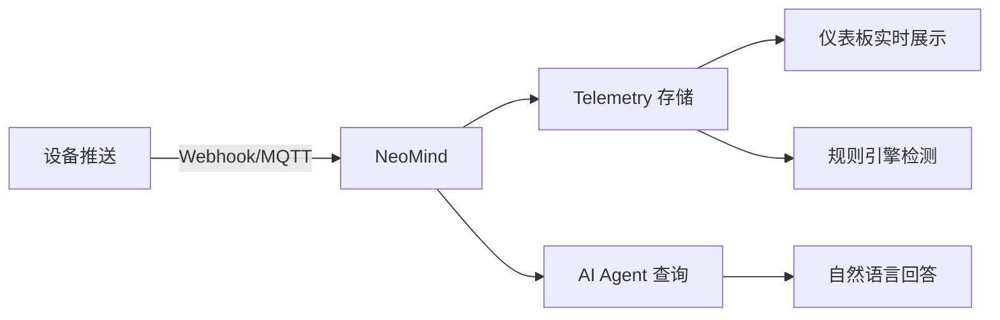

# 5 分钟快速上手

用最短时间跑通 NeoMind 的核心闭环：**设备接入 → 数据可视化 → AI 对话**。每一步都有 ✓ 检查点、排障提示，跟着做就能成。

> 完整安装选项与排障见 [安装与配置](../user-guide/1-install-setup.md)。

---

## 你将完成什么

按照本指南，你将在 5 分钟内：

- ✅ 在本地跑起 NeoMind 服务
- ✅ 下载内置模型——AI 完全本地运行,零 API Key
- ✅ 连接第一个设备并用 webhook 推送数据
- ✅ 在仪表板上看到实时数据
- ✅ 用自然语言向 AI 提问并得到答案

:::tip 前置条件

- 一台 **macOS / Windows / Linux** 电脑（4GB+ 内存）
- **不需要**预先安装数据库、消息代理或其他基础设施——NeoMind 全部内置
- 用内置本地模型(默认路线)预留额外 3-4GB 内存;只想用云端 API 可跳过
  :::

---

## Step 1：安装 NeoMind（约 2 分钟）

三种安装方式任选其一——都自带 Web UI 与 MQTT Broker，**不需要**数据库、消息代理等任何外部组件。

### 方式一：安装包（桌面应用，推荐入门）

**适合**：在个人电脑上体验，不想碰终端。

1. 打开 [GitHub Releases](https://github.com/camthink-ai/NeoMind/releases/latest)，在最新版本中按系统下载安装包：
   - macOS（Apple Silicon）→ `.dmg`
   - Windows（x86_64）→ `.msi` / `.exe`
   - Linux（x86_64 / arm64）→ `.AppImage` / `.deb` / `.rpm`
2. 双击安装并启动：
   - **macOS**：将 NeoMind 拖入「应用程序」。首次打开若提示"无法验证开发者"，在终端执行 `xattr -cr /Applications/NeoMind.app` 后再打开（或在"系统设置 → 隐私与安全性"点"仍要打开"）
   - **Windows**：SmartScreen 提示时点"更多信息 → 仍要运行"
   - **Linux**：`.deb` 双击安装或 `sudo apt install ./neomind-*.deb`；`.AppImage` 先 `chmod +x` 再双击运行

**访问方式**：桌面版启动后直接打开应用原生窗口，无需浏览器。

### 方式二：命令行（本机或服务器）

**适合**：Linux 主机上长期运行。

1. 执行安装脚本（需要 root 或 sudo；自动下载静态二进制、注册 systemd 服务）：

```bash
curl -fsSL https://raw.githubusercontent.com/camthink-ai/NeoMind/main/scripts/install.sh | sh
```

2. 脚本完成即已启动——二进制装到 `/usr/local/bin`，服务名 `neomind`：

```bash
systemctl status neomind    # 应显示 active (running)
```

3. 常用环境变量（执行前 export）：`PORT=9375`（服务端口）、`INSTALL_DIR`（安装目录）、`NO_SERVICE=true`（只装二进制不注册服务）

**访问方式**：本机安装用 `http://localhost:9375`；装在远程服务器则用 `http://<服务器IP>:9375`（无浏览器时可用 `ssh -L 9375:localhost:9375 user@server` 端口转发）。

### 方式三：Docker（本机或容器主机）

**适合**：已有 Docker 的环境，想要最干净的部署与升级体验。

前置：已安装 Docker（Linux 上需要 sudo 或将用户加入 docker 组）。

1. 一条命令启动（含数据持久化）：

```bash
docker run -d --name neomind \
  -p 9375:9375 -p 1883:1883 \
  -v neomind-data:/app/data \
  camthink/neomind:latest
```

镜像（多架构 amd64 + arm64）已内置 llama.cpp 运行时与默认模型 LFM2.5-2.6B，首次运行自动就位。也可用 `docker compose up -d`（编排文件见 [安装与配置](../user-guide/1-install-setup.md#docker-部署)）。

2. 确认启动：`docker logs -f neomind`（等待就绪输出，Ctrl+C 退出）

**访问方式**：Docker 在本机用 `http://localhost:9375`；在远程主机则用 `http://<主机IP>:9375`（端口映射已由 `-p` 完成）。

> 数据目录请使用命名 volume（如上）。若 bind-mount 宿主机目录到 `/app/data`，镜像预置的模型会被跳过，需改走下载 API。

---

## Step 2：注册管理员并登录（30 秒）

浏览器打开访问地址后，首次使用会进入**创建管理员账号**页面：

1. 填写用户名与密码（**务必记牢**——平台数据加密密钥与该账号绑定），邮箱可选
2. 点击 **Get Started** 完成创建，随后登录

<div style={{display: 'flex', gap: '8px', flexWrap: 'wrap'}}>
  
  
</div>

> ✓ **检查点**：登录后进入 AI Chat 与使用引导 = 账号就绪，引导里就能直接进行 Step 3。

:::note 登录遇到问题？

- **忘记密码？** 服务器上执行 `neomind user reset-password admin` 重置
- **页面空白？** 确认访问的是 Step 1 中对应安装方式的地址（本机 localhost / 远程 IP）
  :::

---

## Step 3：下载内置模型——给 NeoMind 装上“大脑”（1-2 分钟）

下载入口有两处，内容完全相同，任选其一：

- **登录后的使用引导内（推荐）**：引导流程的『配置 AI 模型』步骤中，内置模型卡片直接点 **Download**
- **设置 → LLM Backends**：顶部 **Built-in Model** 卡片 → **Download**（之后补装、换模型也在这一张卡片上）

**无后端时的缺省引导页**——刚注册、还没有任何 LLM 后端时，AI Chat 会直接显示这个引导：


点击后开始下载平台推荐模型（约 1.5GB，实时进度、支持断点续传），完成后自动就绪：


> ✓ **检查点**：卡片显示 **Running** 并出现 **Switch Model / Activate** 按钮 = 大脑已就位。

:::tip 跳过这步也能聊
全新实例即使不手动下载，AI Chat 也可直接使用——模型选择器会自动落在**内置模型（llama.cpp auto）**，首次对话时平台自动拉取默认模型：


手动 Download 的价值在于**提前完成下载并固定模型**，避免首次对话时等待。
:::

无需 API Key、无需安装 Ollama 或 Docker、全程离线。想换目录里其他模型（含 0.7GB 视觉款 MiniCPM-V）或导入自己的 GGUF？点 **Switch Model**，详见 [配置 LLM 后端](../user-guide/2-configure-llm.md)。

:::note 下载或激活失败？

- **内存不足预警？** 内置模型最低 3GB 内存，紧张时可换更轻量模型或改用云端
- **下载中断？** 支持断点续传，再次点击 Download 会继续
- **激活按钮灰色？** 等卡片状态变为 Running 再点 Activate
  :::

## Step 4：连接第一个设备（1 分钟）

最快的接入方式是 **HTTP Webhook**——无需 MQTT 客户端，一行 `curl` 就能模拟设备。

### 3.1 创建设备

在 Web UI 的 **设备** 页面 → 点 **添加设备** → 选 **Webhook** → 命名 `demo-sensor`。

创建后会得到一个专属的 Webhook URL（形如 `/api/devices/<DEVICE_ID>/webhook`）。

<div style={{display: 'flex', gap: '8px'}}>
  
  
</div>

### 3.2 推送数据

复制下面的命令，把 `<DEVICE_ID>` 替换为你的设备 ID，执行：

```bash
curl -X POST http://localhost:9375/api/devices/<DEVICE_ID>/webhook \
  -H 'Content-Type: application/json' \
  -d '{"temperature": 25.6, "humidity": 60}'
```

返回 `{"success": true}` 即成功。打开设备详情页，可以看到最新遥测值。


> ✓ **检查点**：设备详情页显示 `temperature: 25.6` 和 `humidity: 60` = 数据已入库。

:::tip 也可以连接真实设备

NeoMind 内置 MQTT Broker（`localhost:1883`），支持 ESP32、树莓派、工业传感器等真实设备。详见 [接入设备](../user-guide/3-onboard-device.md)。
:::

:::note webhook 返回 404？

- **设备 ID 不对？** 在设备列表里点进设备，URL 里的 ID 就是
- **忘了 `Content-Type`？** 必须加 `-H 'Content-Type: application/json'`
  :::

<!-- 截图说明：添加设备弹窗 + webhook URL + 设备详情遥测数据 -->

---


## Step 5：在仪表板看数据（30 秒）

进入 **仪表板** 页面，创建一个仪表板（选择 **Overview** 模板或空白画布），然后添加一个 **数值卡** 组件：

1. 点 **添加组件** → 选 **数值卡**
2. 数据源填 `device:demo-sensor:temperature`
3. 保存


:::info DataSourceId 格式

数据源引用格式统一为 `{type}:{id}:{field}`：

- `device:demo-sensor:temperature` — 设备遥测
- `extension:weather-forecast:temperature` — 扩展指标
- `transform:temp-converter:temp_f` — 数据转换输出
- `ai:温度巡检:verdict` — AI Agent 结构化输出（AI 生成的虚拟指标）

仪表板、规则、数据推送都用这个格式。AI Agent 的结构化输出会自动生成 `ai:` 前缀的虚拟指标（见 Step 3 与 [AI Agent](../user-guide/6-ai-agent.md)）。详见 [术语表](../concepts/1-glossary.md)。
:::

温度值实时显示在卡片上。再推一条 webhook 数据，数值会立即刷新：

```bash
curl -X POST http://localhost:9375/api/devices/<DEVICE_ID>/webhook \
  -H 'Content-Type: application/json' \
  -d '{"temperature": 28.3, "humidity": 55}'
```

> ✓ **检查点**：仪表板上看到实时温度数值 = 可视化闭环打通。

> 详见 [使用仪表板](../user-guide/4-use-dashboard.md)。

<!-- 截图说明：仪表板编辑态 + 数值卡配置 + 实时数据 -->

---


## Step 6：用 AI Chat 提问（30 秒）

打开 **AI Chat**，输入：

> 我有哪些设备？demo-sensor 的温度是多少？

AI Agent 会自动查询设备列表和最新遥测值，用自然语言回答。


再试一个更有挑战性的——让 AI 帮你创建自动化：

> 温度超过 30 度时通知我

AI 会理解你的意图，创建一条规则并配置通知渠道。

> ✓ **检查点**：AI 回答了你的问题 = 智能闭环完成。

:::note AI 没反应？

- **LLM 后端未连接？** 回到 **设置 → LLM 后端** 检查状态
- **第一次回答较慢？** 本地模型首次推理需要预热，等待 10-20 秒正常
  :::

> 详见 [AI Chat](../user-guide/5-ai-chat.md)。

<!-- 截图说明：AI Chat 对话界面，包含设备查询和温度回答 -->

---

## 🎉 核心闭环已完成

回顾你刚才跑通的链路：



**每一环都已验证**：数据进得来、存得下、看得见、能问答。

---

## 下一步

恭喜！你已完成 NeoMind 核心闭环。接下来可以：

| 我想... | 去哪里 |
|---------|--------|
| 深入理解系统架构 | [核心概念](../concepts/2-core-concepts.md) — 进程模型、数据流、扩展机制 |
| 查术语含义 | [术语表](../concepts/1-glossary.md) — Device / Extension / Agent / Rule |
| 配置更多 LLM 后端 | [配置 LLM 后端](../user-guide/2-configure-llm.md) — Ollama / 云端 API |
| 接入真实设备 | [接入设备](../user-guide/3-onboard-device.md) — MQTT / BLE / Webhook |
| 让 AI 自动巡检 | [AI Agent](../user-guide/6-ai-agent.md) — 定时/事件触发的自主智能体 |
| 设自动化规则 | [自动化规则](../user-guide/7-automation-rules.md) — 阈值告警 / 联动控制 |
| 配通知渠道 | [通知](../user-guide/8-notifications.md) — 邮件 / 飞书 / 钉钉 / Webhook |
| 装扩展（YOLO/OCR） | [扩展管理](../user-guide/9-extensions.md) — 安装与配置视觉 AI 扩展 |
| 看端到端实战 | [应用案例](../use-cases/1-object-detection.md) — 目标检测完整方案 |
| 遇到问题 | [故障排查](../user-guide/10-troubleshooting.md) — 常见问题与解决方案 |

---

*最后更新: 2026-10-21*
