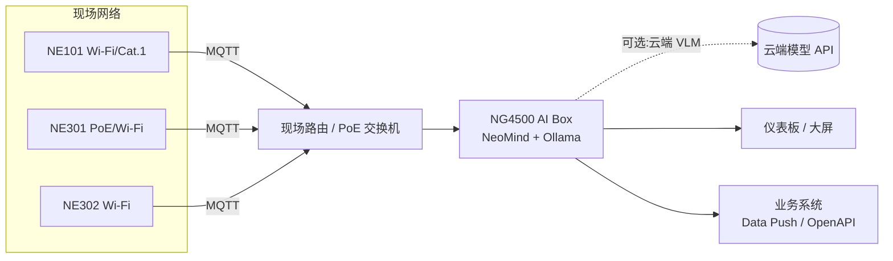

# 工程指南

本页面向实施与集成工程师,覆盖视觉大模型场景理解方案从选型、部署到联调与业务对接的完整工程过程。

## 1. 方案场景

本方案面向**识别目标多变、问题开放、需要"看懂"而不只是"认出"**的视觉场景:巡检类(安全装备、现场状态)、核查类(货架陈列、物品到位)、监控类(满溢、占位、异常)。

### LLM 理解 vs 固定模型:先做选型判断

视觉大模型不是替代 OCR / YOLO,而是补位它们覆盖不了的场景。规划时先按下表分诊:

| 特征 | 适合固定模型(OCR / YOLO 扩展) | 适合本方案(视觉大模型场景理解) |
|---|---|---|
| 识别目标 | 固定不变(表盘字轮、80 类物体) | 多变、长尾、描述性(状态、规范、异常) |
| 输出 | 类别、坐标、确定文字 | 描述、判断、结论、建议 |
| 频率 | 高频 / 视频级实时 | 秒级到分钟级抽样足够 |
| 需求变化 | 每次变化要重训模型 | 改提示词即上线 |
| 典型问题 | "画面里有没有人?" | "现场作业是否规范?有什么风险?" |

> 混合用法常见:高频固定检测交给 YOLO 扩展做第一道过滤,命中后再触发 Agent 做细粒度理解,兼顾成本与深度。两者在 NeoMind 中共存,见 [自动化规则](../../neomind/user-guide/automation-rules) 的 `TRIGGER_AGENT` 联动。

### 典型场景

| 场景 | 抓拍内容 | 提示词定义的分析任务 | 推荐相机 |
|---|---|---|---|
| 工地 / 车间巡检 | 作业面定时抓拍 | 安全帽 / 工装穿戴是否规范,有无违规作业与风险 | NE301 / NE101 |
| 门店货架核查 | 货架定时抓拍 | 陈列是否整齐、缺货 / 空位、价签与商品对应 | NE101 / NE302 |
| 垃圾桶 / 料仓满溢 | 桶口定时抓拍 | 满溢程度分级,超阈值告警 | NE101(电池 + 4G) |
| 仪表 / 屏幕复核 | 表盘 / 显示屏抓拍 | 读数复核、指针位置、异常状态灯判断 | NE101(表盘支架) |
| 农业长势巡检 | 作物 / 牲畜定时抓拍 | 长势描述、异常行为、健康状况初筛 | NE301(太阳能) |
| 出入口状态 | 门口事件抓拍 | 门是否关闭、有无堆物、人员进出概况 | NE302(磁吸安装) |

## 2. 相机选型

三款 NeoEyes 相机都输出 JPEG 图像、都经 MQTT 回传 NeoMind,按点位条件选型:

| | **NE101** | **NE301** | **NE302** |
|---|---|---|---|
| 定位 | 低功耗电池 sensing 相机 | 模块化边缘 AI 相机 | 迷你集成视觉模组 |
| 供电 | 4 节 AA 电池(续航以年计)/ 定制直供电 | 电池 / Type-C / 太阳能 / PoE | USB Type-C(整机)/ DC(主板) |
| 网络 | Wi-Fi(含 HaLow)/ Cat.1 | Wi-Fi 6 / Cat.1 / PoE 模块可换 | Wi-Fi 6 + BLE |
| 端侧 AI | — | 0.6 TOPS,可跑 YOLOv8n 等本地推理与触发 | 0.6 TOPS(INT8) |
| 触发 | 定时 / 按键 | 定时 / PIR / 雷达 / IO / MQTT 远程 / AI 检测 | 定时 / Trigger 按键 / 远程 |
| 防护与安装 | IP67,支架体系 | IP67,墙装 / 杆装 / 表盘支架 | 室内磁吸 / 3M 胶,42×42×20mm |
| 适合点位 | 无电无网户外、表井、农田 | 需端侧过滤或稳定供电的车间、农场 | 室内设备集成、出入口、工位 |

选型经验:

- **户外无市电** → NE101 电池型优先,采集频率与续航线性相关,按巡检周期反推
- **需要端侧预处理**(先本地检测、有目标才上报)→ NE301,用端侧模型过滤可显著降低回传与 LLM 调用量
- **室内集成 / 快速验证** → NE302 迷你形态磁吸即装;无线与接口形态以交付版本为准

## 3. 方案组成(BOM)

| # | 采购项 | 型号 / 规格 | 数量 | 用途 |
|---|---|---|---|---|
| 1 | [**NeoEyes 相机**](https://www.camthink.ai/) | NE101 / NE301 / NE302,按第 2 节选型 | 每点位 1 台 | 现场抓拍 |
| 2 | [**NG4500 AI Box**](https://www.camthink.ai/product/neoedge-ai-box-ng4500/) | Linux 边缘主机 | 1 台(每站点) | 运行 NeoMind:接入、VLM 分析、入库、仪表板 |
| 3 | 视觉大模型 | 本地:Ollama 视觉模型;或云端 VLM API | 1 套 | 图像理解推理 |
| 4 | 供电与网络附件 | 电池 / 支架 / PoE 交换机 / SIM 卡 | 按需 | 部署配套 |

> 起步配置:**3~5 台相机 + 1 台 NG4500 + Ollama 本地视觉模型**即可完整跑通;点位增加只扩相机,平台与模型不变。

## 4. 组网拓扑



通用要求:

- 相机与 NG4500 **接入同一局域网**(或经 HaLow 网关 / 蜂窝回传),主机无需公网
- 相机需可路由至 NeoMind 的 MQTT 端口(内置 Broker,默认 TCP 1883,可启用 MQTTS,主机侧对设备网段放行)
- 图像分析与入库都在 NG4500 本地完成;仅选择云端 VLM 时,主机需可访问对应 API 域名
- 带宽:定时抓拍类流量很小(单张 JPEG 数百 KB × 采集频率),常规局域网即可承载

## 5. 方案搭建

按以下顺序:先安装 NeoMind 与视觉模型,再接入相机,然后创建图像理解 Agent,最后四环联调。

### 5.1 安装 NeoMind(NG4500)

方案主机推荐 **NG4500 AI Box**;评估阶段也可用任意 Linux 主机 / 个人电脑。

- **平台安装**:一键脚本 / 手动部署 / HTTPS 配置,见 [安装与升级](../../neomind/user-guide/install-setup)
- 安装完成后浏览器访问 `http://<主机IP>:9375`,注册管理员账号(平台数据加密密钥与此绑定,务必记牢)

### 5.2 配置视觉 LLM 后端

视觉能力由 LLM 后端提供,**本地与云端二选一或并存**,见 [配置 LLM 后端](../../neomind/user-guide/configure-llm)。

**方式一:本地 Ollama(推荐起步,数据不出场)**

1. 在 NG4500 上安装 Ollama 并拉取视觉模型:

```bash
ollama pull minicpm-v   # 或 llava 等
```

2. NeoMind Web → LLM 后端 → 添加 Ollama 后端,选择该模型
3. NeoMind 自动探测多模态能力;若探测不准,在后端详情页手动打开 **Multimodal** 开关
4. `llm test` 测试连通后,可将小视觉模型设为默认,复杂分析场景再绑定更强的云端后端

**方式二:云端 VLM(推理更强,需外网)**

- 添加 OpenAI / Anthropic / Qwen / GLM 等后端,选择 `gpt-4o` / `claude-sonnet-4-5` / `qwen-vl` / `glm-4v` 等视觉模型,填入 API Key

> 每个 Agent 可独立绑定 LLM 后端(与 Chat 模型解耦)——常见组合:巡检类 Agent 用本地小视觉模型控成本,异常复核 Agent 用云端大模型保质量。

下图为演示环境的实际配置:Ollama 后端接入本地 `minicpm-v`,NeoMind 自动探测到多模态能力(卡片上的"眼睛"标识),无需 API Key、数据不出场。


### 5.3 接入相机设备

1. 平台确认内置 **ne101_camera** 摄像头组件可用(接收相机上报图像)
2. 使用设备类型模板 `ne101_camera` / `ne301_camera` 添加设备并绑定项目,记录 **MQTT Server Address** 与 **Data Reporting Topic**
3. 相机侧配置上报:NE101 长——按拍照键开 AP,Web UI 填入上述 MQTT 信息;NE301 / NE302 在各自 Web 控制台的 MQTT 上报页配置,具体以 [NE101](../../neoeyes-ne101-series/quick-start) / [NE301](../../neoeyes-ne301-series/quick-start) / [NE302](/docs/neoeyes-ne302-series/ne302-quick-start) 快速入门为准
4. 上报成功后设备进入待审核列表,审核通过即接入

三台相机接入后的设备列表——一张 NE301 负责工地东门,两台 NE101 分别盯着门店货架与垃圾收集点:


相机上报的每一帧都落盘为设备的 `image` 指标(URL 引用原图),在设备详情页可直接预览缩略图,并保留 Capture / Sleep 等远程命令:


### 5.4 创建图像理解 Agent

进入 **Agents** 页面创建 Agent(完整字段说明见 [AI Agent](../../neomind/user-guide/ai-agent))。按业务形态选执行方式:

**推荐:结构化模式(Structured)——结果直接入库为指标**

1. **Execution Mode** 选 `Structured`,绑定相机设备(图像数据源)
2. **输出字段** 定义 Schema——每个字段含名称、类型(Number / Text / Boolean / Enum)、单位与描述:

| 字段 | 类型 | 单位 | 描述(写入提示词) |
|---|---|---|---|
| `helmet_count` | Number | 人 | 画面中佩戴安全帽的人数 |
| `violation` | Enum: none, no_helmet, no_vest | — | 违规类型:无违规 / 未戴帽 / 未穿工装 |
| `scene_summary` | Text | — | 一句话描述现场作业状态 |

3. **User Prompt** 写清分析要求与判定口径(示例见第 6 节)
4. 调度选 **Event**(新画面到达即分析)或 **Cron**(定时抽样,6 字段表达式,如 `0 */30 * * * *` 每 30 分钟)
5. LLM Backend 绑定 5.2 配置的视觉模型,保存后状态为 Active

每次执行:图像以多模态消息注入 → 单次受约束推理 → 字段经 Schema 校验 → 以 **`ai:{agent_id}:{字段}` 虚拟指标**写入时序库,仪表板可直接选用。

演示环境按此方式创建了三个结构化 Agent——Site Safety Patrol(工地安全)、Shelf Audit(货架核查)、Bin Fill Check(垃圾桶满溢),全部 Event 触发、绑定同一本地视觉模型:


Agent 详情页集中呈现结构化定义:User Prompt、Output fields(每个字段即一个 `ai:{agent}:{field}` 数据源)、Schedule(event)与绑定的视觉模型:


**备选:Focused / Free 事件模式——分析更自由**

- 绑定相机设备 + Event 触发,图像自动注入;Agent 可多轮调用工具(查历史、发通知、执行命令),结论记录在执行历史中
- 适合"判断 + 联动动作"的复合任务(如:识别到违规 → 查该设备最近数据 → 发飞书告警)
- 结果要入库时,可配合 [数据转换](../../neomind/user-guide/7b-data-transforms) 从输出 JSON 解析字段为虚拟指标

### 5.5 联调(四环验证)

按顺序逐环验证,任一环不通先排查该环:

1. **抓拍到达**:手动触发一次抓拍,确认图像出现在相机组件与设备数据中
2. **Agent 执行**:Agent 详情 → Execute Now,执行历史出现记录且状态 Completed;失败看 `error` 字段(常见:后端 Multimodal 未开启、模型不是视觉模型)
3. **指标入库**:设备 / 指标列表出现 `ai:{agent_id}:*` 虚拟指标且有新数据点
4. **仪表板呈现**:仪表板添加该指标卡片,数值随抓拍刷新

四环全过 = 链路验收通过。

演示环境的联调记录:执行历史 5 次全部 Completed(单次 8~10 秒,本地 1B 视觉模型):


点开任意一次执行,可完整回看这次分析:输入包含抓拍原图,输出为经 Schema 校验的 JSON(含置信度),并提示字段已发布为虚拟指标——这正是"全量留痕、结论可回溯"的落点:


### 5.6 数据存储与展示

分析结果的三个落点,按需取用:

| 落点 | 内容 | 用途 |
|---|---|---|
| **虚拟指标**(时序库) | 结构化字段(`ai:{agent_id}:*`) | 趋势曲线、同环比、告警规则、仪表板卡片 |
| **执行记录**(JSON) | 完整推理链:收集 → 分析 → 决策 → 结论 + 耗时 | 单次结论回溯、审计、调提示词的依据 |
| **Agent 记忆** | journal 摘要与知识文件 | 跨次执行的上下文积累(现场基线、历史事件) |

- **抓拍原图**:存储于 NG4500,保留周期在数据保留设置中控制,到期自动清理
- **仪表板建议三块**:最新状态卡片(最新结论 + 时间)、指标趋势曲线(违规次数 / 状态分布)、图像流(相机组件实时画面 + 抓拍历史);搭建见 [使用仪表板](../../neomind/user-guide/use-dashboard)
- 执行记录中的结构化 JSON 可经 REST API 拉取,归档到业务侧数据仓库

### 5.7 数据转发(可选)

| 方式 | 说明 | 适用 |
|---|---|---|
| **Data Push** | 指定虚拟指标的新数据点实时推送到业务 HTTP 端点(含重试) | 实时联动、大屏 |
| **OpenAPI 拉取** | 业务系统按周期调用 REST API 拉取指标与执行记录 | 日报 / 周报系统 |

- 配置方法:[数据转发](../../neomind/user-guide/7c-data-push) / [平台 API](../../neomind/developer-guide/rest-api)
- 违规告警、设备离线等事件走 [消息通知](../../neomind/user-guide/notifications) 的 Webhook / IM / 邮件渠道
- 字段映射示例:点位 ↔ 设备 ID;违规类型 ↔ `ai:{agent_id}:violation`;结论凭证 ↔ 执行记录 ID + 抓拍原图 URL

## 6. 提示词与场景示例

提示词质量直接决定分析质量。写法三原则:**角色 + 判定口径 + 输出要求**,并把"不确定就说不确定"写进提示词,压低幻觉。

**示例一:工地安全巡检(结构化 + Event)**

```text
你是工地安全巡检员。分析画面中的作业人员:
1. 统计画面中人数与佩戴安全帽人数;
2. 判定违规类型:无违规 / 未戴安全帽 / 未穿反光衣 / 多种违规;
3. 用一句话描述现场作业状态(在做什么、有无风险);
4. 光线不足、人员过小无法确认时,violation 输出 none 并在
   scene_summary 注明"画面条件不足",不要臆测。
```

**示例二:货架陈列核查(结构化 + Cron 每 2 小时)**

```text
你是门店陈列核查员。对照陈列标准分析货架画面:
1. 判断是否出现明显空位或缺货(以货架层板裸露为准);
2. 统计可见商品排面数;
3. 判断陈列是否整齐(商品是否推至货架前沿);
4. 结论只基于画面可见内容,看不清的层位在 summary 中说明。
```

**示例三:异常复核 + 联动告警(Focused/Free + Event)**

```text
你是仓储现场监控员。分析刚上报的画面:
1. 判断是否存在异常(火情迹象、大量烟雾、人员跌倒、通道堵塞);
2. 若疑似异常:查询该设备最近 1 小时的指标数据交叉验证,
   确认后发送告警消息(标题含点位名与异常类型);
3. 若正常或无法确认:简短记录即可,不发告警;
4. 如果 journal 显示最近 10 分钟已就同一事件发过告警,不要重复发送。
```

调优经验:误报多 → 收紧判定口径、增加"不确定时输出保守值";漏报多 → 降低判定门槛、提高采集频率;输出漂移 → 检查输出字段描述是否与提示词口径一致。

## 7. 频率与资源规划

| 规划项 | 参考值 | 说明 |
|---|---|---|
| 采集频率 | 状态类 5~30 分钟/次;出入口事件触发 | 频率 × 点位数 = VLM 调用量,线性相关 |
| 本地 VLM 吞吐 | 4B 级模型单张秒级(视主机配置) | 试点阶段先用低频 Cron 观察耗时再放量 |
| 结构化 Agent 限流 | 合并窗口默认 30s;可设每日调用上限 | 到量自动暂停至次日,防失控;连续失败熔断,保留最后有效值 |
| 图像尺寸 | 单张 ≤ 10MB;分析前自动缩到 1280px 内 | 超分辨率细节(如远距离小字)需靠近拍摄 |
| 执行超时 | 单次 Agent 执行最长 5 分钟 | 结构化模式单次推理默认 60s 超时 |
| 数据保留 | 原图与指标按保留策略自动清理 | 长期归档走 Data Push / OpenAPI 外移 |

成本经验:本地 Ollama 模型无边际成本,适合高频巡检;云端 VLM 按调用计费,适合低频深度复核——两者可按 Agent 粒度混搭。

## 8. 技术支持

- **社区支持**:[Discord](https://discord.gg/a8NbPGAJw9) / [GitHub Discussions](https://github.com/camthink-ai/community/discussions)
- **方案定制与批量部署**:[联系我们](https://www.camthink.ai/company/contact-us/),由 CamThink 技术支持团队对接
- **私有化模型适配 / 场景提示词调优 / 大规模点位规划**:同上,请在需求中注明点位数量、采集频率与目标模型

## 了解更多

- [方案说明](solution-description)
- [NeoMind 用例:相机 AI 流水线与 Agent 视觉分析](../../neomind/use-cases/camera-ocr)
- [AI Agent 使用指南](../../neomind/user-guide/ai-agent) · [配置 LLM 后端](../../neomind/user-guide/configure-llm)
- [NeoEyes NE101](../../neoeyes-ne101-series/overview) · [NE301](../../neoeyes-ne301-series/overview) · [NE302](/docs/neoeyes-ne302-series/ne302-overview)
