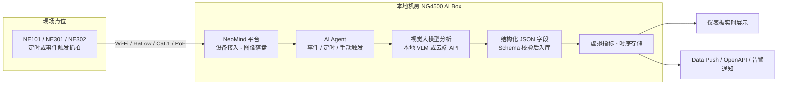

*实时演示:相机抓拍到达 → Agent 自动调用视觉大模型分析 → 人数卡片、趋势曲线、图像流与执行记录实时刷新(录屏 3 倍速)*

## 方案背景

视觉 AI 落地现场时,最常见的做法是为每个识别目标训练或选配一个**固定模型**:OCR 认表盘、YOLO 认安全帽、人脸模型认员工。这类方案精度高、延迟低,但有两个天然短板:

- **一个目标一个模型**:新增一个识别需求(比如从"认安全帽"变成"判断安全帽是否戴规范"),就意味着新一轮数据采集、标注、训练、量化与部署,长尾场景的迭代成本始终降不下来
- **只会"认出",不会"看懂"**:固定模型输出类别和坐标,回答不了"现场现在什么情况""有没有异常风险""该怎么处理"这类开放式问题

把图像上云调用视觉大模型 API 可以解决"看懂"的问题,但图像要出内网——工厂、农场、仓库场景中,原始画面外发往往过不了安全审查,还要承担按调用计费与外网依赖的运维风险。

## 方案介绍

本方案的思路是:**用提示词定义视觉任务,让多模态大模型在本地把画面"读"成结构化数据。**

在点位部署 CamThink **NeoEyes** 系列相机——低功耗电池型的 **NE101**(4 节 AA 电池续航以年计)、模块化边缘 AI 型的 **NE301**(0.6 TOPS,可端侧运行检测模型先过滤再上报)或迷你集成型的 **NE302**(磁吸即装)——按定时或事件触发抓拍现场画面,通过 Wi-Fi / Cat.1 / PoE 网络回传至本地机房或机柜中的 **NG4500 AI Box**;盒内运行的 **NeoMind 平台**以 AI Agent 承接每一帧图像,调用多模态大模型(视觉 LLM,如本地 Ollama 的 MiniCPM-V 或云端视觉 API)按提示词完成理解,把结果落成**经过 Schema 校验的结构化 JSON 字段**——人数、违规类型、满溢等级、读数……作为虚拟指标写入时序库,并在仪表板上实时呈现。

整个过程只有三步闭环:**相机抓拍 → 大模型按提示词理解 → 结构化字段入库上板**。与大模型的所有交互都在 NG4500 上完成:选择本地视觉模型时,**图像与识别结果全程不出场**;需要更强推理质量时,也可为单个 Agent 绑定云端视觉模型,按需混搭。

提示词即任务:安全帽巡检、货架陈列核查、垃圾桶满溢监控、仪表读数复核、工位在岗检测……同一个平台、同一套流程,**改一段提示词和几个输出字段,就是一个新的视觉应用**,不需要重新训练任何模型。

## 方案组成(BOM)

| # | 组成 | 型号 / 规格 | 数量 | 职责 |
|---|---|---|---|---|
| 1 | 边缘 AI 相机 | NeoEyes **NE101**(电池长续航)/ **NE301**(边缘 AI + 模块化)/ **NE302**(迷你集成) | 每点位 1 台 | 定时或事件触发抓拍,图像经 MQTT 回传 |
| 2 | 边缘计算主机 | **NG4500 AI Box** | 每站点 1 台 | 运行 NeoMind 平台:设备接入、图像落盘、Agent 编排、时序存储、仪表板 |
| 3 | 视觉大模型 | 本地 Ollama(**MiniCPM-V** 等)或云端 VLM API(GPT-5 / Claude / Gemini / Qwen3-VL 等) | 1 套 | 按提示词完成图像理解;本地数据不出场,云端推理更强,可按 Agent 混搭 |
| 4 | NeoMind 平台 | NG4500 内置 | — | 设备接入、AI Agent、虚拟指标、自动化规则、Data Push / OpenAPI |
| 5 | 供电与网络附件 | 电池 / 支架 / PoE 交换机 / SIM 卡 | 按需 | 相机部署配套 |

起步配置:**3~5 台相机 + 1 台 NG4500 + 一套本地视觉模型**即可完整跑通;点位增加只扩相机,平台与模型不变。完整选型对比、组网拓扑与部署步骤见 [工程指南](./engineering-guide)。

## 工作流程

1. **抓拍回传** — NeoEyes 相机按定时 / 传感器触发 / 远程指令抓拍,图像经 MQTT 上报 NeoMind
2. **Agent 触发** — 新画面到达即触发事件型 Agent(也可按 Cron 定时或手动执行),图像自动注入分析上下文
3. **视觉理解** — 多模态 LLM 按提示词分析画面:描述现场、识别目标、判断状态、给出结论与建议
4. **结构化入库** — 输出字段经 Schema 校验(Number / Text / Boolean / Enum),以 `ai:{agent_id}:{字段}` 虚拟指标写入时序库;完整分析过程(收集 → 推理 → 决策 → 结论)以 JSON 留档
5. **可视与出口** — 仪表板实时展示最新结论与历史趋势;异常结果联动告警通知,数据经 Data Push / OpenAPI 对接业务系统

## 核心特点

- **提示词即任务**:不改代码、不训模型,改提示词和输出字段定义即可切换分析目标,新场景当天上线
- **开放式理解**:不止认出目标,还能描述现场、判断异常、解释原因、给出建议——把"检测"升级为"看懂"
- **数据不出场**:视觉模型可全本地运行(Ollama),图像、结果、记忆全部留在 NG4500,内网部署无外发
- **结果即指标**:LLM 输出经 Schema 校验后直接成为时序虚拟指标,历史趋势、同环比、告警规则、仪表板全部现成可用
- **全量留痕**:每次分析绑定抓拍原图与完整推理过程 JSON,结论可回溯、可审计
- **一平台多相机**:NE101(电池长续航)、NE301(边缘 AI + 模块化)、NE302(迷你集成)统一接入,按点位条件选型

## 方案效果

- 视觉需求的交付从"一轮模型开发"缩短为"写一段提示词",长尾场景的试点与切换成本大幅下降
- 分析结论自动入库并实时上板,巡检从人工看画面转向看仪表板与趋势
- 现场画面与识别结果留在本地网络,满足工厂、农业、仓储等场景的数据合规要求
- 识别质量受提示词质量、画面清晰度与模型能力影响,部署时以现场实测为准;结论存在概率性判断,关键业务建议保留人工复核通道

以下是本方案在 NeoMind 演示环境中的真实运行效果(工地安全巡检场景):结构化 Agent 对每帧抓拍输出人数、合规数与违规类型,字段直接成为时序指标,与抓拍画面同屏呈现。

同一套流程换个提示词与输出字段,即得到门店货架核查与垃圾桶满溢监控两个仪表板:

## 了解更多

- [工程指南:选型 / 组网 / 搭建 / 联调 / 运维](engineering-guide)
- [NeoMind 用例:相机 AI 流水线与 Agent 视觉分析](../../neomind/use-cases/camera-ocr)
- [NeoMind 平台文档](../../neomind/product-overview/what-is-neomind)
- [NeoEyes NE101 产品概述](../../neoeyes-ne101-series/overview) · [NE301](../../neoeyes-ne301-series/overview) · [NE302](/docs/neoeyes-ne302-series/ne302-overview)
