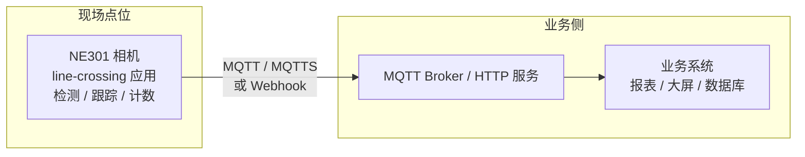

# 工程指南

本页面向实施与集成工程师,覆盖过线统计方案从选型、安装、配置到数据对接与日常运维的完整工程过程。方案定位与业务价值见 [方案说明](solution-description)。

## 1. 方案场景

方案的核心动作只有一个:**在画面里画一条计数线,统计穿越它的目标**。预置人形检测模型时,典型场景包括:

| 场景 | 统计口径 | 典型用途 |
|---|---|---|
| 门店出入口 | 进/出双向客流 | 排班、陈列调整、转化率分析 |
| 通道 / 动线 | 单向或双向流量 | 动线热度、高峰时段识别 |
| 办公区 / 车间出入口 | 进出统计 | 在场人数、通勤时段分析 |

统计对象由端侧模型决定,换场景有两条路(部署与切换操作见 4.3):

- **用现成模型**:从 [CamThink Model Zoo](https://www.camthink.ai/developer-center/models/) 下载场景调优的示例模型部署使用
- **训自己的模型**:针对特殊目标按现场样本训练专属检测模型后部署,训练与部署流程见 [模型训练与部署](../../neoeyes-ne301-series/application-guide/model-training)

### 安装位置选择

- **取景**:镜头俯视覆盖计数断面,目标在画面中保持足够的像素大小(避免过远过小导致漏检);画面亮度尽量均匀,避免逆光
- **画线**:计数线横跨统计断面,与目标行进方向大体垂直;线两侧留出目标完整通行空间,避免目标贴边通过
- **供电与联网**:实时统计需持续供电,优先 Type-C 电源直供;网线方便的点位选 PoE 模组(供电 + 以太网一线解决);无 Wi-Fi 的室外点位选 Cat-1 模组
- **安装验证**:支架固定前,在应用实时画面中确认:目标大小合适、计数线可横跨断面、方向语义正确(外侧朝向目标来向),再锁定支架

<!-- TODO(现场拍摄): 安装位置示意图 -->

## 2. 方案组成(BOM)

| # | 采购项 | 型号 / 规格 | 数量 | 用途 |
|---|---|---|---|---|
| 1 | **NE301 AI 相机** | STM32N6,0.6 TOPS;通讯模组 Wi-Fi 6 / Cat-1 / PoE 按点位选 | 每点位 1 台 | 端侧检测、跟踪、越线计数 |
| 2 | line-crossing 应用 | `.neapp` 应用包,随方案交付 | 1 套 | 画线配置、实时统计、窗口报告 |
| 3 | 供电附件 | Type-C 电源 / PoE(与通讯模组配套) | 按需 | 相机供电 |
| 4 | 网络附件 | Wi-Fi 接入点 / PoE 交换机 / SIM 卡(按通讯模组) | 按需 | 相机联网与数据回传 |
| 5 | 业务系统接收端 | MQTT Broker(含 MQTTS)或 HTTP Webhook 服务 | 1 套 | 接收窗口报告 |

> 低成本起步:**1 台 NE301(Type-C 供电 + Wi-Fi)+ 应用包 + 现有 MQTT/Webhook 接收端**即可完成一个点位部署;点位增加只加相机,接收端不变。

## 3. 组网拓扑



通用要求:

- 相机与接收端之间 IP 可达即可;接收端可留在本地网络(数据不出场),也可按需对接云端
- MQTT 与 Webhook 是两条独立通道,在应用"高级设置"里分别开关:可只用其一,也可同时启用互为备份
- 断网期间,容量内的窗口报告暂存于设备,网络恢复后尽力补发;设备断电可能丢失尚未送达的报告,关键统计建议业务侧按日对账(见 5.4)

## 4. 方案搭建

按以下顺序:相机上线 → 安装应用 → 设定模型与目标类别 → 画线 → 参数配置 → 统计与上报 → 联调验证。使用预置人形模型时,在 4.3 确认目标类别即可。

### 4.1 相机上线

1. 完成 NE301 组装、供电与联网,流程见 [NE301 快速入门](../../neoeyes-ne301-series/quick-start)
2. 浏览器访问相机 Web 界面并登录
3. 确认左侧导航存在**应用管理**页(即设备固件已具备应用宿主能力);固件不支持时,刷入 [ne301 仓库的 app-host 固件](https://github.com/camthink-ai/ne301/tree/app-host)后再继续

### 4.2 安装 line-crossing 应用

1. 从 [ne30x-app Releases](https://github.com/camthink-ai/ne30x-app/releases) 下载 line-crossing 的 `.neapp` 应用包
2. 进入**应用管理 → ⚙ 管理应用**,按界面提示导入 `.neapp` 应用包完成安装

   <!-- TODO(现场核查): 全新安装流程截图;MQTT/MQTTS 与 Webhook 标签页的服务器配置字段(待现场补核后补充字段表) -->

3. 安装后应用状态为**已安装 / 运行中**,实时画面与应用界面直接嵌在应用状态页
4. 应用管理操作:

| 操作 | 行为 |
|---|---|
| 停止 | 结束应用运行;**停止后才能更新或卸载** |
| 更新应用 | 运行中禁用(提示"应用正在运行,无法更新或卸载;请先停止应用后再试");普通升级保留业务数据 |
| 卸载应用 | 运行中禁用;卸载会**同时清除该应用的业务配置、累计计数与待发报告**,重装后从零开始 |

### 4.3 设定模型与目标类别

方案的统计对象由端侧检测模型决定:**先确定模型与目标类别,再画线**。预置人形检测模型开箱即用——只统计人流时,确认目标类别为 person 即可进入 4.4;更换统计目标需两步:更换检测模型并切换目标类别,均在设备侧完成。

**模型来源与部署**

- **现成模型**:从 [CamThink Model Zoo](https://www.camthink.ai/developer-center/models/) 下载场景调优的模型(PT / ONNX / TFLite)
- **自训模型**:针对自己的场景与目标训练专属模型——YOLO 训练 → TFLite 导出 → 量化 → 部署的完整流程见 [模型训练与部署](../../neoeyes-ne301-series/application-guide/model-training)
- **部署到设备**:推荐 Web UI 上传方式(见上述指南第 4 章;也可经系统设置的固件升级页上传模型包);模型就位后应用即可绑定

<div style={{ display: 'flex', justifyContent: 'center' }}>
  
</div>

*模型上传入口:功能调试页 → Camera Settings → upload,选择模型文件上传,设备加载后生效*

**设定/切换目标类别(应用内)**

1. 参数配置页 → 基础设置 → **目标类别**:下拉框列出当前绑定模型的全部类别,下方显示当前模型名称

2. 选择新目标类别并保存,应用弹出确认:**"切换目标类别将开启新的统计周期:当前窗口计数、累计计数与事件将被清零。确定继续?"**
3. 确认后生效:跟踪器按新目标重建,开始新的统计周期

<div style={{ display: 'flex', justifyContent: 'center' }}>
  
</div>

*参数配置页:目标类别下拉列出当前绑定模型的类别,下方显示当前模型*

切换目标类别的清零语义:

| 数据 | 切换目标类别后 |
|---|---|
| 本窗口计数 / 累计计数 / 过线事件 | 清零,新统计周期开始 |
| 已发出的历史窗口报告 | 保留,不受影响 |
| 报告序号 `report_seq` | 不回退,继续单调递增 |
| 画线 / 跟踪参数 / 上报配置 | 保留不变 |

<!-- TODO(现场核查): 部署新模型后,应用是否需要重启才能读取新模型的类别列表(待现场验证后补充) -->

### 4.4 画线与方向

1. 实时数据页 → **绘制计数线**:在画面上两次点击确定线的两个端点,拖动任一端点可微调(支持鼠标与触摸)
2. 进出方向由线的内外侧决定:目标从外侧穿到内侧计"进入",反之为"离开";方向不对时点**交换进出方向**一键翻转
3. 画错的线点**重置**(重置画线)后重新绘制
4. 保存后配置经设备校验生效;改线只影响后续判定,**累计计数保留**(重新定义统计口径时用"重置统计数据",见 4.7)

<div style={{ display: 'flex', justifyContent: 'center' }}>
  
</div>

*实时数据页:检测框、计数线、方向箭头与运动轨迹实时叠加*

穿线后实时统计立即更新,"最近过线事件"表同步新增一条记录(Track 编号、检测对象、方向、时间):

<div style={{ display: 'flex', justifyContent: 'center' }}>
  
</div>

*穿线计数:OUT 7→8,累计 OUT 12489→12490,事件表新增 #8 person OUT 记录*

### 4.5 参数配置

参数配置页分两组,保存后生效。

**基础设置**

| 字段 | 作用 | 说明 |
|---|---|---|
| 计数器名称 | 写入报告的 `counter.counter_name` | 自定义命名(如"客流统计");多点位时按断面命名便于区分 |
| 目标类别 | 当前绑定的检测目标 | 由端侧模型决定,设定与切换见 4.3;**更换目标类别会清零累计计数并要求二次确认** |

**跟踪参数**(影响跟踪与越线判定的灵敏度)

| 字段 | 作用 | 范围 | 何时调整 |
|---|---|---|---|
| 置信度阈值 (0-1) | 检测框采纳门槛 | 0~1 | 误检多 → 调高;漏检多 → 调低 |
| 关联距离 (0-1) | 相邻帧目标位置关联半径 | 0~1 | 目标移动快 / 画面大 → 调大;不同目标错配 → 调小 |
| 轨迹长度 | 每条轨迹保留的历史点数 | 4~16 | 越线判定需要更平滑轨迹时调大 |
| 最大丢失帧 | 轨迹允许连续丢失的帧数 | ≥1 | 短暂遮挡多 → 调大,避免轨迹断裂导致重复计数 |
| 确认帧数 | 轨迹转正所需确认帧数 | ≥1 | 误检抖动多 → 调大;要求快速响应 → 调小 |

> 调参以现场实测为准:确认帧数 / 最大丢失帧调小可能引入重复计数,调大可能漏计快速通过的目标。

### 4.6 统计与上报

高级设置页分两组,**各自独立保存**。

**App 管理的设置**(统计业务)

| 字段 | 作用 | 说明 |
|---|---|---|
| 统计周期 (分钟) | 窗口报告的汇总周期 | 1~1440 分钟;客流场景建议从 5 分钟起步 |
| 附带轨迹 | 窗口报告附带过线轨迹明细 | 需要回放过线明细时开启,数据量相应增大 |

**Host 管理的设置**(上报通道)

| 字段 | 作用 | 说明 |
|---|---|---|
| MQTT 上报 | 启用 MQTT 通道 | 服务器在**MQTT/MQTTS** 标签页配置 |
| Webhook 上报 | 启用 Webhook 通道 | 服务器在**Webhook** 标签页配置 |
| 离线积压容量 | 断网期间暂存的报告条数 | 可配置范围以设备实机为准;容量满后新报告不再入队 |

### 4.7 联调验证

1. **计数**:人员以正常速度往返穿过计数线数次,实时统计的"本周期进入 / 离开"与实际次数一致,"最近过线事件"表逐条对应
2. **口径归零**:正式统计前点**重置统计数据**开始干净口径(确认弹窗:"将清零累计计数、事件与离线积压,且不可恢复。业务配置不受影响。")
3. **上报**:业务侧订阅 MQTT / 查看 Webhook 接收日志,确认按统计周期收到窗口报告
4. **断网积压**:断开网络超过一个统计周期后恢复,确认积压报告补发到达

四项验证全部通过,点位交付验收即完成。

## 5. 数据对接

### 5.1 报告机制

- 应用按统计周期生成 `line_counting` 窗口报告,由设备统一经 MQTT / Webhook 发送;应用自身不建立网络连接
- 每条报告带 `report_seq`(单调递增)与 `boot_id`(设备本次启动标识):消费方以 `boot_id + report_seq` 判重与排序,补发或重试可能带来重复
- 时间字段当前版本为设备运行毫秒(`window.start_ms / end_ms`),`reported_at` 为空——消费方应以接收时间建立时间轴,并按 `boot_id` 识别设备重启
- 断网积压为尽力补发:容量内暂存、恢复后重发;已开始发送的请求不保证撤回

### 5.2 窗口报告字段(v4.2.8)

| 字段 | 类型 | 说明 |
|---|---|---|
| `type` | string | 固定 `line_counting` |
| `device_id` | string | 设备标识 |
| `app.app_id` / `app.sw_version` | string | 应用标识与版本 |
| `boot_id` | number | 设备本次启动标识,重启后变化 |
| `report_seq` | number | 报告序号,单调递增 |
| `clock_valid` | boolean | 设备时钟是否有效(当前版本为 false) |
| `reported_at` | null | 预留的墙钟时间,当前版本为空 |
| `window.start_ms` / `end_ms` | number | 统计窗口起止(设备运行毫秒) |
| `window.duration_sec` | number | 窗口时长(秒) |
| `window.in` / `window.out` | number | 本周期进入 / 离开计数 |
| `window.carried_in` / `carried_out` | number | 本周期内应用重启前已累计、重启后恢复的进 / 出计数 |
| `window.data_quality.complete` | boolean | 本窗口数据是否完整(无断流 / 丢帧) |
| `window.data_quality.gaps` | number | 窗口内断流次数 |
| `window.data_quality.lost_frames` | number | 丢失帧数 |
| `window.data_quality.frames_unusable` | number | 不可用帧数 |
| `total.in` / `total.out` | number | 自上次清零起的累计进 / 出 |
| `counter.counter_name` | string | 计数器名称(参数配置中设置) |
| `target.class_name` | string | 目标类别 |
| `model.name` / `model.version` | string | 当前绑定的检测模型 |
| `line.x1 / y1 / x2 / y2` | number | 计数线端点坐标(千分比 0~1000,与分辨率无关) |
| `line.outside_x / outside_y` | number | 外侧参考点坐标(千分比) |
| `config.confidence_threshold` | number | 报告生成时的置信度阈值(千分比) |

### 5.3 报文示例

```json
{
  "type": "line_counting",
  "device_id": "NE301-XXXXXXXX",
  "app": { "app_id": "line-crossing", "sw_version": "4.2.8" },
  "boot_id": 3,
  "report_seq": 128,
  "clock_valid": false,
  "reported_at": null,
  "window": {
    "start_time": null,
    "end_time": null,
    "start_ms": 3600000,
    "end_ms": 3900000,
    "duration_sec": 300,
    "in": 12,
    "out": 9,
    "carried_in": 0,
    "carried_out": 0,
    "data_quality": {
      "complete": true,
      "gaps": 0,
      "lost_frames": 0,
      "lost_unknown": false,
      "frames_unusable": 0,
      "persist_ok": true
    }
  },
  "total": { "in": 1246, "out": 1180 },
  "counter": { "counter_name": "客流统计" },
  "target": { "class_name": "person" },
  "model": { "name": "line-crossing", "version": "1.0.0" },
  "line": {
    "x1": 420, "y1": 800, "x2": 580, "y2": 800,
    "outside_x": 500, "outside_y": 1000
  },
  "config": { "confidence_threshold": 500 }
}
```

> 示例中的数值均为示意;字段结构与 v4.2.8 应用一致,后续版本可能演进,以交付版本的字段说明为准。

### 5.4 业务侧消费建议

- **判重幂等**:`boot_id + report_seq` 唯一确定一条报告,按此键做幂等处理
- **时间轴**:以接收时间或业务侧时钟对齐窗口;多点位汇总时统一到墙钟
- **质量过滤**:`data_quality.complete = false` 的窗口用于提示与核查,不建议直接进正式报表
- **按日对账**:每日以 `total` 口径与窗口累加口径比对,识别漏发 / 丢报告

## 6. 日常运维

| 现象 / 任务 | 处置 |
|---|---|
| 查看运行状态 | 应用管理 → 应用状态页:应用状态与实时统计同屏 |
| 实时画面不显示 | 画面区有连接状态提示(实时播放 / 重连中 / 不可用),与应用运行状态相互独立;断流先查网络 |
| 修改配置 | 实时数据 / 参数配置 / 高级设置页修改后保存生效;改线、调参不影响累计计数 |
| 开始新统计口径 | 重置统计数据(清零累计、事件与积压;配置保留;不可恢复) |
| 更新应用 | 先停止应用 → 更新应用;普通升级保留业务数据 |
| 恢复初始状态 | 停止应用 → 卸载应用(同时清除该应用全部业务数据;重装后从零开始) |
| 误计 / 漏计排查 | 检查画线位置与方向(4.4);按 4.5 调跟踪参数;必要时采集现场样本训练专属模型并切换目标类别提升精度(见 4.3) |

## 7. 性能与规格

| 指标 | 数值 |
|---|---|
| 预置模型 | 人形检测,随应用交付 |
| 自定义模型 | [CamThink Model Zoo](https://www.camthink.ai/developer-center/models/) 示例模型下载;自训模型按[模型训练与部署](../../neoeyes-ne301-series/application-guide/model-training)流程部署 |
| 统计周期 | 1~1440 分钟可配 |
| 计数线 | 每应用 1 条,坐标 0~1000 千分比 |
| 累计口径 | 断电保持;重置统计数据或更换目标类别时清零 |
| 离线积压 | 容量可配,实际上限以设备实机为准;恢复后尽力补发 |

方案定位流量趋势分析而非计量级精度:统计精度受安装角度、光照与目标密集程度影响,并可通过现场样本训练优化模型逐步改善,部署时以现场实测为准。

## 8. 技术支持

- **社区支持**:[Discord](https://discord.gg/a8NbPGAJw9) / [GitHub Discussions](https://github.com/camthink-ai/community/discussions)
- **方案定制与批量部署**:[联系我们](https://www.camthink.ai/company/contact-us/),请注明点位规模与现有业务系统对接方式

## 了解更多

- [方案说明](solution-description)
- [NeoEyes NE301 产品概述](../../neoeyes-ne301-series/overview)
- [NE301 快速入门](../../neoeyes-ne301-series/quick-start)
- [模型训练与部署(NE301 应用指南)](../../neoeyes-ne301-series/application-guide/model-training) · [CamThink Model Zoo](https://www.camthink.ai/developer-center/models/)
- ne30x-app 开源仓库:[github.com/camthink-ai/ne30x-app](https://github.com/camthink-ai/ne30x-app)
