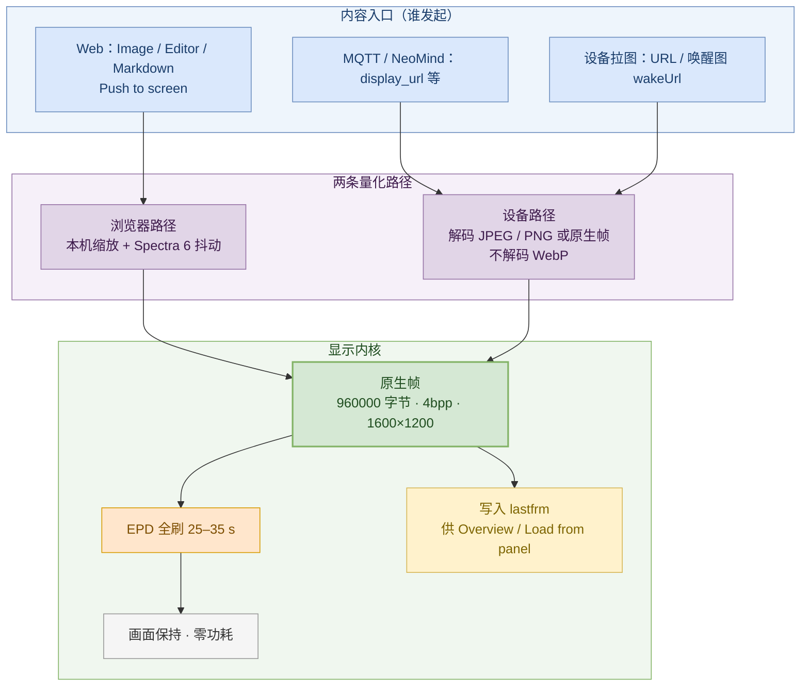
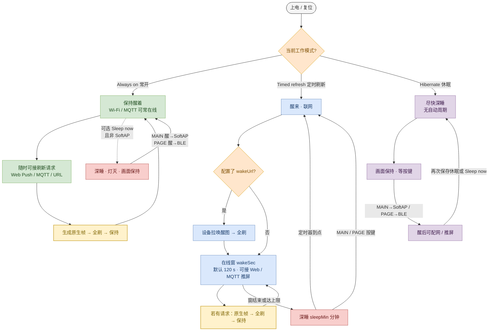

import ApplicationScenarios from '@site/src/components/ApplicationScenarios';
import SupportGrid from '@site/src/components/SupportGrid';

# Product Information

  

## 产品简介

CamThink EK410 是一款 **7.09″ 六色电子纸标牌（E-Paper Signage）**：在反射式、类纸面的 E Ink Spectra 6 面板上展示品牌信息、议程与公告，支持无线更新内容，内置可充电电池，无需常接电源即可桌面或壁挂使用。

面板分辨率为 1200 × 1600（282 PPI），可显示黑 / 白 / 红 / 黄 / 蓝 / 绿六色；全刷约 25–35 秒，适合低频更新。软件完全开源：浏览器 Web UI 上传画面，也可接入 [NeoMind](https://wiki.camthink.ai)；固件主控为 ESP32-C61，SoftAP 网页或 [NeoLinker](https://github.com/camthink-ai/NeoLinker) BLE CT-Prov 完成配网后，可在浏览器中配置 Wi-Fi / MQTT、推送图片与排版、设置电源策略并 OTA。SoftAP 与 BLE 共用**同一固件镜像**，运行时互斥。

墨水屏只在刷新时耗电，最后一帧断电后依然保持显示——换内容不必再换纸质插页。

### 产品外观

  <figure style={{ margin: 0, textAlign: 'center' }}>
    
    <figcaption style={{ fontSize: '0.85rem', opacity: 0.75, marginTop: '6px' }}>左前 45°</figcaption>
  </figure>
  <figure style={{ margin: 0, textAlign: 'center' }}>
    
    <figcaption style={{ fontSize: '0.85rem', opacity: 0.75, marginTop: '6px' }}>右前 45°</figcaption>
  </figure>
  <figure style={{ margin: 0, textAlign: 'center' }}>
    
    <figcaption style={{ fontSize: '0.85rem', opacity: 0.75, marginTop: '6px' }}>后侧</figcaption>
  </figure>
  <figure style={{ margin: 0, textAlign: 'center' }}>
    
    <figcaption style={{ fontSize: '0.85rem', opacity: 0.75, marginTop: '6px' }}>背面</figcaption>
  </figure>

### 屏幕效果

E Ink Spectra 6 六色面板可呈现黑 / 白 / 黄 / 红 / 蓝 / 绿；以下为设备正面屏幕效果示意（渲染图，非实拍）。

  
  
  
  

  
  
  
  
  
  

### 核心能力

- **六色电子纸显示**：E Ink Spectra 6，1200 × 1600 / 282 PPI，黑 / 白 / 红 / 黄 / 蓝 / 绿；反射式类纸显示，断电保持。
- **电池安装、无线换图**：内置 5000 mAh 可充电锂电，USB Type-C 充电；浏览器 Web UI 推送内容，同一块屏可在会议、职场与活动间复用。
- **双通道配网**：长按 MAIN 开启 SoftAP + Web 控制台；长按 PAGE 进入 BLE CT-Prov（NeoLinker）。二者进程内互斥。
- **多种内容来源**：本地上传、图片 URL、画布编辑器、Markdown，均可在浏览器预览后上屏。
- **NeoMind / 开源**：设备类型 `ek410_Eink`；可与 NeoMind 开源部署联用；固件与 Web UI 见 [github.com/camthink-ai/EK410](https://github.com/camthink-ai/EK410)。
- **灵活电源与 OTA**：常开 / 定时刷新 / 休眠；HTTPS OTA + 双分区回滚。

## 产品规格

整机规格对齐 CamThink 产品画册；固件侧能力（分区、按键 GPIO、MQTT 等）以 [固件仓库](https://github.com/camthink-ai/EK410) 与本 Wiki 硬件 / 软件指南为准。

<table>
  <thead>
    <tr>
      <th>分类</th>
      <th>项目</th>
      <th>规格</th>
    </tr>
  </thead>
  <tbody>
    <tr>
      <td rowspan="7">显示</td>
      <td>面板</td>
      <td>E Ink Spectra 6 有源矩阵电泳屏（EPD），六色：黑 / 白 / 红 / 黄 / 蓝 / 绿</td>
    </tr>
    <tr>
      <td>尺寸</td>
      <td>7.09″（对角线）</td>
    </tr>
    <tr>
      <td>有效显示区</td>
      <td>108 × 144 mm</td>
    </tr>
    <tr>
      <td>分辨率</td>
      <td>1200 × 1600（H × V），282 PPI</td>
    </tr>
    <tr>
      <td>固件画布</td>
      <td>逻辑 1600 × 1200（原生 1200 × 1600，双驱动 IC）</td>
    </tr>
    <tr>
      <td>帧格式</td>
      <td>960000 字节原生 4bpp，每字节 2 像素</td>
    </tr>
    <tr>
      <td>全刷时间</td>
      <td>约 25–35 秒</td>
    </tr>
    <tr>
      <td rowspan="8">整机与供电</td>
      <td>外形尺寸</td>
      <td>185 × 149 × 14 mm</td>
    </tr>
    <tr>
      <td>净重</td>
      <td>0.28 kg</td>
    </tr>
    <tr>
      <td>安装</td>
      <td>桌面支架杆或壁挂</td>
    </tr>
    <tr>
      <td>电池</td>
      <td>内置可充电锂聚合物 5000 mAh</td>
    </tr>
    <tr>
      <td>续航</td>
      <td>最长约 6 个月（按每天刷新 1 次估算；实际因用法而异）</td>
    </tr>
    <tr>
      <td>充电</td>
      <td>USB Type-C</td>
    </tr>
    <tr>
      <td>工作温度</td>
      <td>0–50 °C</td>
    </tr>
    <tr>
      <td>存储环境</td>
      <td>−20–60 °C，湿度 30–90% RH</td>
    </tr>
    <tr>
      <td rowspan="8">主控与接口</td>
      <td>主控</td>
      <td>ESP32-C61HR2，RISC-V，160 MHz</td>
    </tr>
    <tr>
      <td>Flash / PSRAM</td>
      <td>16 MB / 2 MB</td>
    </tr>
    <tr>
      <td>无线</td>
      <td>Wi-Fi 6（802.11ax）；BLE 5.0（固件 SoftAP / STA 为 2.4 GHz；画册另列频段时以交付硬件为准）</td>
    </tr>
    <tr>
      <td>存储卡</td>
      <td>MicroSD（TF）</td>
    </tr>
    <tr>
      <td>按键</td>
      <td>Power / Reset / Switch（固件名 MAIN / PAGE / BOOT / RESET，见硬件指南）</td>
    </tr>
    <tr>
      <td>USB</td>
      <td>Type-C 充电；CH340 USB-UART 开发调试</td>
    </tr>
    <tr>
      <td>云平台</td>
      <td>NeoMind，设备类型 <code>ek410_Eink</code></td>
    </tr>
    <tr>
      <td>本地配置</td>
      <td>SoftAP + Web 控制台（<code>http://192.168.4.1</code>）；NeoLinker CT-Prov</td>
    </tr>
    <tr>
      <td rowspan="4">包装清单</td>
      <td>电子纸显示终端</td>
      <td>× 1</td>
    </tr>
    <tr>
      <td>桌面支架杆</td>
      <td>× 1</td>
    </tr>
    <tr>
      <td>USB Type-C 充电线</td>
      <td>× 1</td>
    </tr>
    <tr>
      <td>用户手册（电子版）</td>
      <td>× 1</td>
    </tr>
  </tbody>
</table>

## 显示更新原理

墨水屏**没有连续播放**：只有收到一次刷新请求才做一次**全刷**（约 25–35 s）；刷完后画面**零功耗保持**，直到下一次请求。三种工作模式决定「设备醒着时能不能随时接请求」，不改变「原生帧 → 全刷」这条显示内核。

### 1. 内容怎么变成一屏（所有模式共用）

| 路径 | 典型场景 | 要点 |
| :--- | :--- | :--- |
| **浏览器路径** | SoftAP / LAN 打开控制台，Image 上传或 Editor / Markdown 推屏 | 六色化在浏览器完成，设备只收原生帧，通常最快 |
| **设备路径** | MQTT `display_url`、定时刷新的 **wakeUrl**、部分 URL 拉图 | 设备自己解码；**WebP 不支持**；画质受 System → URL image Quality / Speed 影响 |

### 2. 三种工作模式下的综合逻辑

工作模式在 **System → Work mode**（常开 / 定时刷新 / 休眠）。下图把「何时醒、能否推屏、何时睡」与上面的显示内核串在一起：

| 模式 | 显示相关行为 | 典型用法 |
| :--- | :--- | :--- |
| **Always on（常开）** | 一直醒着，**随时** Web / MQTT 推屏；画面刷完即保持 | 调试、频繁改内容、要 MQTT 常在线 |
| **Timed refresh（定时刷新）** | 醒 →（可选 **wakeUrl** 自动刷一屏）→ `wakeSec` 内可再推屏 → 睡 `sleepMin` → 循环 | 看板：隔 N 分钟换图，省电 |
| **Hibernate（休眠）** | 深睡保画，**无定时自醒**；MAIN / PAGE 才醒，醒后再推屏 | 长期不改画面、极度省电 |

:::note 与显示无关但会影响「能不能刷」的约束
- **SoftAP 开着时**：一般不入睡（避免配网中途睡死）；`Sleep now` 会被拒绝。
- **全刷进行中**：新推屏会 busy，需等本次 25–35 s 结束。
- **成功用户刷屏**才写 `lastfrm`；SoftAP 引导页 / 开机 logo 不写入。
:::

操作步骤与字段见[电源管理](./2-user-guide/2-power-management.md)；MQTT 刷屏指令见[MQTT 协议](./4-software-guide/2-mqtt-protocol.md)。

## 与 NeoMind 平台集成

设备配置好 Wi-Fi 与 MQTT 后会出现在 NeoMind 平台的设备列表（待审批），审批通过后即可：

- 接收设备的周期遥测（信号、电量、内存、固件版本等）；
- 通过下行指令清屏、渲染文字 / 画布、拉取 URL 图片、休眠与重启；
- 用平台规则或 Agent 在内容变化时调用 `display_url` 把新画面推上屏。

MQTT 主题与指令格式详见 [MQTT 协议](./4-software-guide/2-mqtt-protocol.md)。

## 产品应用

EK410 面向**室内商用标牌**：信息随场次、活动或活动档期变化，电池供电便于无常供电点位摆放，内容无线更新，减少反复印制与更换纸质插页。以下为产品定位示例（含场景示意渲染），正式部署前请结合刷新频率与供电验证。

<ApplicationScenarios
  introduction="典型场景：办公与商业空间、会议会展、精品零售与品牌柜台、酒店校园与公共空间。内容可由 Web 控制台或 NeoMind 规则更新。"
  imagePosition="left"
  imageHeight={200}
  maxDescriptionLines={8}
  categories={[
    {
      title: '办公与商业空间',
      items: [
        {
          title: '部门牌 / 会议室标识 / 通讯录',
          description: '保持岗位与会议室信息最新，无需更换纸质插页；日程变化时无线推送。',
          image: '/img/epaper-ek410-series/overview/scenarios/meeting.webp',
          imageAlt: '会议室门牌示意',
        },
        {
          title: '机房与设备状态',
          description: '汇总机柜或告警摘要；适合弱电间等不便频繁换纸的位置。',
          image: '/img/epaper-ek410-series/overview/scenarios/equipment.webp',
          imageAlt: '机房状态示意',
        },
      ]
    },
    {
      title: '会议、活动与展会',
      items: [
        {
          title: '讲者名牌 / 议程 / 欢迎牌',
          description: '场次之间重新指派画面，同一设备跨活动复用；六色区分标题、时段与须知。',
          image: '/img/epaper-ek410-series/overview/scenarios/production.webp',
          imageAlt: '活动信息板示意',
        },
        {
          title: '停车与动线指引',
          description: '显示分区指引或临时公告；内容变化时远程推送，日常常显不耗电。',
          image: '/img/epaper-ek410-series/overview/scenarios/parking.webp',
          imageAlt: '引导牌示意',
        },
      ]
    },
    {
      title: '零售与公共空间',
      items: [
        {
          title: '精品零售 / 品牌柜台',
          description: '商品说明、柜台促销与品牌故事；适合有计划的低频更新陈列。',
          image: '/img/epaper-ek410-series/overview/scenarios/supermarket.webp',
          imageAlt: '零售柜台示意',
        },
        {
          title: '仓储与库位标识',
          description: '库位号、出库队列与班次状态；变化时由平台规则触发刷新。',
          image: '/img/epaper-ek410-series/overview/scenarios/warehouse.webp',
          imageAlt: '仓储看板示意',
        },
      ]
    },
  ]}
/>

## 产品资源

### Wiki 指南

- [快速入门](./1-quick-start.md)：完成上电、配网和第一次内容推送。
- [用户指南](./2-user-guide/0-softap-provisioning.md)：深入了解配网、内容显示、电源管理与系统维护。
- [硬件指南](./3-hardware-guide/0-specifications.md)：查看规格、按键、指示灯与分区表。
- [软件指南](./4-software-guide/0-development-environment.md)：搭建 ESP-IDF 环境并编译、烧录固件。

## 技术支持

遇到产品或固件问题时，请提供设备固件版本（Web 控制台"系统"页可见）、复现步骤和脱敏后的日志。不要在工单、截图或公开文档中包含 Wi-Fi 密码、MQTT 凭据、MAC 地址或序列号。

<SupportGrid />
