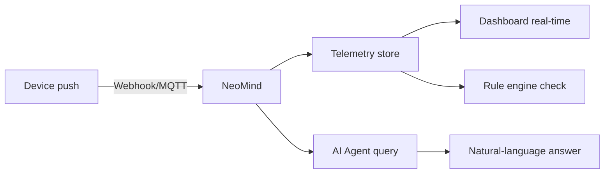

# 5-Minute Quick Start

Experience NeoMind's core loop — **device ingress → data visualization → AI conversation** — as fast as possible. Each step has a ✓ checkpoint and troubleshooting tips.

> For full installation options and troubleshooting see [Install & Setup](../user-guide/1-install-setup.md).

---

## What You'll Achieve

By the end of this guide you will have:

- ✅ A NeoMind service running locally
- ✅ A large language model connected (local or cloud)
- ✅ Your first device connected and pushing data via webhook
- ✅ Live data visible on a dashboard
- ✅ Asked the AI a question in natural language and gotten an answer

:::tip Prerequisites

- A **macOS / Windows / Linux** machine (4 GB+ RAM)
- **No** need to pre-install databases, message brokers, or any other infrastructure — everything is built into NeoMind
- For a local LLM (recommended): an extra 4–8 GB RAM; otherwise you can use a cloud API
  :::

---

## Step 1: Install NeoMind (~2 min)

Pick any one of the three install methods — all ship the Web UI and MQTT broker and **require no** databases, message brokers, or other external components.

### Option A: Installer Package (Desktop App, recommended)

**Best for**: trying NeoMind on a personal computer without touching a terminal.

1. Open [GitHub Releases](https://github.com/camthink-ai/NeoMind/releases/latest) and download the package for your system from the latest release:
   - macOS (Apple Silicon) → `.dmg`
   - Windows (x86_64) → `.msi` / `.exe`
   - Linux (x86_64 / arm64) → `.AppImage` / `.deb` / `.rpm`
2. Install and launch:
   - **macOS**: drag NeoMind into Applications. If first launch says "cannot verify developer", run `xattr -cr /Applications/NeoMind.app` in a terminal and open again (or click "Open Anyway" in System Settings → Privacy & Security)
   - **Windows**: on the SmartScreen prompt click "More info → Run anyway"
   - **Linux**: `.deb` installs with a double-click or `sudo apt install ./neomind-*.deb`; `chmod +x` the `.AppImage` and run it

**Access**: the desktop app opens its own native window — no browser needed.

### Option B: Command Line (local machine or server)

**Best for**: running long-term on a Linux host.

1. Run the install script (needs root or sudo; downloads the static binary and registers a systemd service):

```bash
curl -fsSL https://raw.githubusercontent.com/camthink-ai/NeoMind/main/scripts/install.sh | sh
```

2. When the script finishes the service is already running — the binary lands in `/usr/local/bin`, service name `neomind`:

```bash
systemctl status neomind    # should show active (running)
```

3. Useful environment variables (export before running): `PORT=9375` (service port), `INSTALL_DIR` (install directory), `NO_SERVICE=true` (binary only, skip the service)

**Access**: on the same machine use `http://localhost:9375`; on a remote server use `http://<server-IP>:9375` (or forward with `ssh -L 9375:localhost:9375 user@server` when there's no browser).

### Option C: Docker (local machine or container host)

**Best for**: environments that already run Docker, for the cleanest deployment and upgrade experience.

Prerequisite: Docker installed (on Linux you need sudo or membership in the docker group).

1. One command to start (data persisted):

```bash
docker run -d --name neomind \
  -p 9375:9375 -p 1883:1883 \
  -v neomind-data:/app/data \
  camthink/neomind:latest
```

The image (multi-arch amd64 + arm64) ships the llama.cpp runtime and the default model LFM2.5-2.6B, in place on first run. `docker compose up -d` works too (compose file in [Install & Configure](../user-guide/1-install-setup.md#docker)).

2. Confirm startup: `docker logs -f neomind` (wait for the ready output, Ctrl+C to stop)

**Access**: local Docker uses `http://localhost:9375`; on a remote host use `http://<host-IP>:9375` (port mapping done by `-p`).

> Use a named volume for the data directory (as above). Bind-mounting a host directory onto `/app/data` skips the pre-bundled model — use the download API instead.

---

## Step 2: Create the Admin Account & Log In (30 sec)

Opening the access URL for the first time shows the **create admin account** page:

1. Fill in a username and password (**keep them safe** — the platform's data-encryption key is bound to this account); email is optional
2. Click **Get Started** to finish, then log in

<div style={{display: 'flex', gap: '8px', flexWrap: 'wrap'}}>
  
  
</div>

> ✓ **Checkpoint**: after logging in you see the AI Chat welcome page = account ready.

:::note Login trouble?

- **Forgot the password?** Run `neomind user reset-password admin` on the server to reset it
- **Blank page?** Make sure you're using the access URL matching your install method from Step 1 (localhost or the remote IP)
  :::

---

## Step 3: Download the Built-in Model — Give NeoMind a Brain (1–2 min)

There are two entry points with identical content — pick either:

- **In the post-login onboarding (recommended)**: on the wizard's "Configure AI Model" step, the Built-in Model card has a **Download** button
- **Settings → LLM Backends**: the **Built-in Model** card at the top → **Download** (reinstalling or switching models also happens on this card)

**The default guide page when no backend exists** — right after registration, before any LLM backend is configured, AI Chat shows this guide directly:


Clicking starts the platform-recommended model download (~1.5GB, live progress, resumable); when it finishes the model is ready automatically:


> ✓ **Checkpoint**: the card shows **Running** with **Switch Model / Activate** buttons = the brain is in place.

:::tip Skip this step and chat still works
On a brand-new instance, AI Chat works even without the manual download — the model selector automatically lands on the **built-in model (llama.cpp auto)**, and the platform fetches the default model on first use:


The value of clicking Download manually is **finishing the download up front and pinning the model**, avoiding the first-conversation wait.
:::

No API key, no Ollama or Docker install, fully offline. Want one of the other catalog models (incl. the 0.7GB vision variant MiniCPM-V) or to import your own GGUF? Click **Switch Model** — see [Configure LLM Backend](../user-guide/2-configure-llm.md).

:::note Download or activation failed?

- **Low-memory warning?** The built-in model needs 3 GB RAM minimum — switch to a lighter model or use a cloud backend on tight machines
- **Download interrupted?** Downloads resume — click Download again to continue
- **Activate button greyed out?** Wait for the card state to turn Running before activating
  :::

## Step 4: Connect Your First Device (1 min)

The fastest ingress method is **HTTP Webhook** — no MQTT client needed, a single `curl` simulates a device.

### 3.1 Create the device

In the Web UI **Devices** page → click **Add Device** → select **Webhook** → name it `demo-sensor`.

After creation you'll get a dedicated Webhook URL (like `/api/devices/<DEVICE_ID>/webhook`).

<div style={{display: 'flex', gap: '8px'}}>
  
  
</div>

### 3.2 Push data

Copy the command below, replace `<DEVICE_ID>` with your device's ID, and run it:

```bash
curl -X POST http://localhost:9375/api/devices/<DEVICE_ID>/webhook \
  -H 'Content-Type: application/json' \
  -d '{"temperature": 25.6, "humidity": 60}'
```

A `{"success": true}` response means it worked. Open the device detail page to see the latest telemetry values.


> ✓ **Checkpoint**: the device detail page shows `temperature: 25.6` and `humidity: 60` = data is in the database.

:::tip Connect real devices too

NeoMind has a built-in MQTT broker (`localhost:1883`) that supports real devices like ESP32, Raspberry Pi, industrial sensors, and more. See [Onboard Devices](../user-guide/3-onboard-device.md).
:::

:::note webhook returned 404?

- **Wrong device ID?** Click into the device in the device list — the ID is in the URL
- **Forgot Content-Type?** You must include `-H 'Content-Type: application/json'`
  :::

---


## Step 5: See Data on the Dashboard (30 sec)

Go to the **Dashboard** page and create a dashboard (pick the **Overview** template or a blank canvas), then add a **Value Card** widget:

1. Click **Add Widget** → choose **Value Card**
2. Data source → `device:demo-sensor:temperature`
3. Save


:::info DataSourceId Format

The unified data source reference format is `{type}:{id}:{field}`:

- `device:demo-sensor:temperature` — device telemetry
- `extension:weather-forecast:temperature` — extension metric
- `ai:temp-inspector:verdict` — AI Agent structured output (an AI-generated virtual metric)
- `transform:temp-converter:temp_f` — data transform output

Dashboards, rules, and data pushes all use this format. See the [Glossary](../concepts/1-glossary.md).
:::

The temperature value appears live on the card. Push another webhook payload and watch it update instantly:

```bash
curl -X POST http://localhost:9375/api/devices/<DEVICE_ID>/webhook \
  -H 'Content-Type: application/json' \
  -d '{"temperature": 28.3, "humidity": 55}'
```

> ✓ **Checkpoint**: you see a live temperature reading on the dashboard = visualization loop is working.

> See [Use Dashboard](../user-guide/4-use-dashboard.md).

---


## Step 6: Ask AI Chat (30 sec)

Open **AI Chat** and type:

> What devices do I have? What's the temperature of demo-sensor?

The AI Agent will query the device list and latest telemetry, then answer in natural language.


Now try something more ambitious — let the AI create an automation for you:

> Notify me when temperature exceeds 30

The AI will understand your intent, create a rule, and configure a notification channel.

> ✓ **Checkpoint**: the AI answered your question = the intelligence loop is complete.

:::note AI not responding?

- **LLM backend not connected?** Go back to **Settings → LLM Backends** and check status
- **First reply is slow?** Local models need to warm up on first inference — 10–20 seconds is normal
  :::

> See [AI Chat](../user-guide/5-ai-chat.md).

---

## 🎉 Core Loop Complete

Here's the pipeline you just verified end-to-end:



**Every link is verified**: data comes in, gets stored, is visualized, and can be queried.

---

## Next Steps

Congratulations! You've completed the NeoMind core loop. From here:

| I want to... | Go to |
|--------------|-------|
| Understand the architecture | [Core Concepts](../concepts/2-core-concepts.md) — process model, data flow, extension mechanism |
| Look up a term | [Glossary](../concepts/1-glossary.md) — Device / Extension / Agent / Rule |
| Configure more LLM backends | [Configure LLM Backend](../user-guide/2-configure-llm.md) — Ollama / cloud API |
| Connect real devices | [Onboard Devices](../user-guide/3-onboard-device.md) — MQTT / BLE / Webhook |
| Automate with AI Agents | [AI Agent](../user-guide/6-ai-agent.md) — scheduled / event-triggered autonomous agents |
| Set up automation rules | [Automation Rules](../user-guide/7-automation-rules.md) — threshold alerts / linked control |
| Configure notifications | [Notifications](../user-guide/8-notifications.md) — email / Slack / Telegram / Webhook |
| Install extensions (YOLO/OCR) | [Extensions](../user-guide/9-extensions.md) — install and configure vision AI extensions |
| See an end-to-end example | [Use Cases](../use-cases/1-object-detection.md) — full object detection solution |
| Troubleshoot issues | [Troubleshooting](../user-guide/10-troubleshooting.md) — common problems and solutions |

---

*Last updated: 2026-10-21*
