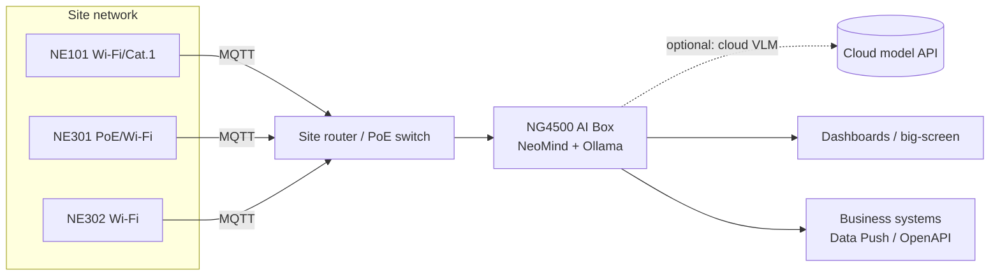

# Engineering Guide

This page is for implementation and integration engineers, covering the complete engineering process of the Vision LLM scene understanding solution from selection and deployment to integration testing and business integration.

## 1. Solution Scenarios

This solution targets vision scenarios where **recognition targets vary, questions are open-ended, and you need to "understand" rather than just "detect"**: inspection (safety equipment, site status), verification (shelf compliance, item placement), and monitoring (overflow, occupancy, anomalies).

### LLM understanding vs fixed models: assess fit first

Vision LLMs do not replace OCR / YOLO — they cover what those cannot. Triage your requirements first:

| Trait | Fixed models (OCR / YOLO extensions) | This solution (Vision LLM scene understanding) |
|---|---|---|
| Recognition target | Fixed (meter dials, 80 object classes) | Varying, long-tail, descriptive (states, compliance, anomalies) |
| Output | Classes, boxes, exact text | Descriptions, judgments, conclusions, recommendations |
| Frequency | High frequency / real-time video | Second- to minute-level sampling is enough |
| Requirement changes | Each change means retraining | Change the prompt to go live |
| Typical question | "Is there a person in the frame?" | "Is the work compliant? What are the risks?" |

> Hybrid patterns are common: high-frequency fixed detection runs on a YOLO extension as the first filter; hits then trigger an Agent for fine-grained understanding — balancing cost and depth. Both coexist in NeoMind; see the `TRIGGER_AGENT` action in [Automation Rules](../../neomind/user-guide/automation-rules).

### Typical scenarios

| Scenario | Capture | Task defined by the prompt | Recommended camera |
|---|---|---|---|
| Construction / workshop inspection | Scheduled shots of work areas | Hard hat / vest compliance, unsafe acts and risks | NE301 / NE101 |
| Retail shelf audit | Scheduled shelf shots | Out-of-stock gaps, facing counts, planogram alignment | NE101 / NE302 |
| Bin / silo overflow | Bin-mouth shots | Overflow level grading, threshold alerting | NE101 (battery + 4G) |
| Meter / screen verification | Dial / display shots | Reading cross-check, needle position, status lights | NE101 (meter bracket) |
| Agriculture growth patrol | Crop / livestock shots | Growth description, abnormal behavior, health screening | NE301 (solar) |
| Entrance monitoring | Event shots at doors | Door open/closed, obstruction, personnel flow | NE302 (magnetic mount) |

## 2. Camera Selection

All three NeoEyes cameras output JPEG images and report to NeoMind over MQTT — pick by site conditions:

| | **NE101** | **NE301** | **NE302** |
|---|---|---|---|
| Positioning | Low-power battery sensing camera | Modular edge-AI camera | Mini integration vision module |
| Power | 4×AA batteries (years of life) / custom wired | Battery / Type-C / solar / PoE | USB Type-C (full unit) / DC (board only) |
| Network | Wi-Fi (incl. HaLow) / Cat.1 | Swappable Wi-Fi 6 / Cat.1 / PoE modules | Wi-Fi 6 + BLE |
| On-device AI | — | 0.6 TOPS, runs YOLOv8n-class local inference | 0.6 TOPS (INT8) |
| Triggers | Schedule / button | Schedule / PIR / radar / IO / MQTT remote / AI detection | Schedule / trigger button / remote |
| Protection & mounting | IP67, bracket system | IP67, wall / pole / meter brackets | Indoor magnetic / 3M pad, 42×42×20mm |
| Best fit | Outdoor sites without power or LAN: wells, farmland | Workshops and farms needing on-device filtering or stable power | Indoor device integration, entrances, workstations |

Selection tips:

- **Outdoor, no mains power** → NE101 battery model first; capture frequency scales battery life linearly — derive frequency from the inspection cycle
- **On-device pre-filtering** (detect locally, upload only on hits) → NE301; local filtering cuts both uplink traffic and LLM call volume significantly
- **Indoor integration / quick pilots** → NE302 mini form factor mounts magnetically; wireless and interface variants depend on the delivered SKU

## 3. Solution Composition (BOM)

| # | Item | Model / Spec | Qty | Purpose |
|---|---|---|---|---|
| 1 | [**NeoEyes camera**](https://www.camthink.ai/) | NE101 / NE301 / NE302, per Section 2 | 1 per site point | Field capture |
| 2 | [**NG4500 AI Box**](https://www.camthink.ai/product/neoedge-ai-box-ng4500/) | Linux edge host | 1 per site | Runs NeoMind: ingestion, VLM analysis, storage, dashboards |
| 3 | Vision LLM | Local: Ollama vision model; or cloud VLM API | 1 set | Image understanding inference |
| 4 | Power & network accessories | Batteries / brackets / PoE switch / SIM | As needed | Deployment kit |

> Starter configuration: **3–5 cameras + 1 NG4500 + a local Ollama vision model** runs the full pipeline. Scaling means adding cameras only — the platform and model stay unchanged.

## 4. Network Topology



General requirements:

- Cameras and the NG4500 join **the same LAN** (or come back via a HaLow gateway / cellular); the host needs no public internet
- Cameras must reach NeoMind's MQTT port (built-in Broker, default TCP 1883, MQTTS available; allow the device subnet on the host firewall)
- Image analysis and storage complete locally on the NG4500; only a cloud VLM choice requires outbound access to the API domain
- Bandwidth: scheduled-capture traffic is small (a few hundred KB per JPEG × capture frequency); any regular LAN carries it

## 5. Solution Setup

Follow this order: install NeoMind and the vision model, onboard cameras, create the image-understanding Agent, then run the four-step integration test.

### 5.1 Install NeoMind (NG4500)

The recommended host is the **NG4500 AI Box**; any Linux machine or personal computer works for evaluation.

- **Platform installation**: one-line script / manual deployment / HTTPS setup — see [Install & Upgrade](../../neomind/user-guide/install-setup)
- After installation, open `http://<host-IP>:9375` and register the admin account (the platform's data-encryption key is bound to it — keep the credentials safe)

### 5.2 Configure the Vision LLM Backend

Vision capability comes from the LLM backend — **local or cloud, either or both**. See [Configure LLM Backends](../../neomind/user-guide/configure-llm).

**Option 1: local Ollama (recommended to start; data stays local)**

1. Install Ollama on the NG4500 and pull a vision model:

```bash
ollama pull minicpm-v   # or llava, etc.
```

2. NeoMind Web → LLM Backends → add an Ollama backend and select the model
3. NeoMind auto-detects multimodal capability; if detection is wrong, flip the **Multimodal** switch on the backend detail page manually
4. Run `llm test` to verify connectivity, then set the small vision model as default — bind a stronger cloud backend for complex-analysis Agents

**Option 2: cloud VLM (stronger reasoning; requires internet)**

- Add an OpenAI / Anthropic / Qwen / GLM backend and pick a vision model such as `gpt-5` / `claude-sonnet-4-5` / `gemini-2.5-flash` / `qwen3-vl` / `glm-4.5v`, with your API key

> Each Agent binds its own LLM backend (decoupled from Chat) — a common mix: inspection Agents on a local small vision model for cost, anomaly-review Agents on a cloud large model for quality.

The demo environment in action: an Ollama backend running local `minicpm-v`, with multimodal capability auto-detected by NeoMind (the "eye" badge on the card) — no API key, data never leaves the box.


### 5.3 Onboard Cameras

1. Confirm the built-in **ne101_camera** component is available on the platform (receives reported images)
2. Add devices with the `ne101_camera` / `ne301_camera` device-type templates, bind them to a project, and note the **MQTT Server Address** and **Data Reporting Topic**
3. Configure reporting on each camera: NE101 — long-press the capture button to open the AP, then fill the MQTT details in its Web UI; NE301 / NE302 — configure on the MQTT reporting page of their web consoles. See the [NE101](../../neoeyes-ne101-series/quick-start) / [NE301](../../neoeyes-ne301-series/quick-start) / [NE302](/docs/neoeyes-ne302-series/ne302-quick-start) quick starts for specifics
4. Reported devices appear in the pending list; approve to complete onboarding

Three cameras onboarded in the demo — one NE301 watching the site's east work area, two NE101s covering a store aisle and a waste collection point:


Every reported frame lands as the device's `image` metric (URL reference to the stored original); the device detail page previews the thumbnail and exposes remote commands such as Capture / Sleep:


### 5.4 Create the Image-Understanding Agent

Go to **Agents** and create an Agent (full field reference in [AI Agent](../../neomind/user-guide/ai-agent)). Choose the execution form by business shape:

**Recommended: Structured mode — results land directly as metrics**

1. Set **Execution Mode** to `Structured` and bind the camera device (image data source)
2. Define the **output fields** schema — each field has a name, type (Number / Text / Boolean / Enum), unit and description:

| Field | Type | Unit | Description (injected into the prompt) |
|---|---|---|---|
| `helmet_count` | Number | person | Number of people wearing hard hats |
| `violation` | Enum: none, no_helmet, no_vest | — | Violation type: none / no helmet / no vest |
| `scene_summary` | Text | — | One-sentence description of site activity |

3. Write the **User Prompt** with analysis requirements and judgment criteria (examples in Section 6)
4. Schedule as **Event** (analyze on every new frame) or **Cron** (sampled polling; 6-field expression, e.g. `0 */30 * * * *` every 30 minutes)
5. Bind the vision backend from 5.2 as the LLM Backend, save — the Agent turns Active

Each run: images injected as multimodal messages → single constrained inference → fields schema-validated → written as **`ai:{agent_id}:{field}` virtual metrics** ready for dashboards.

The demo environment created three structured Agents this way — Site Safety Patrol, Shelf Audit and Bin Fill Check — all Event-triggered, all bound to the same local vision model:


The Agent detail page concentrates the structured definition: User Prompt, Output fields (each field is one `ai:{agent}:{field}` data source), Schedule (event) and the bound vision model:


**Alternative: Focused / Free event mode — more flexible analysis**

- Bind the camera device + Event trigger; images are injected automatically; the Agent can chain tools (query history, send notifications, run commands) with conclusions recorded in execution history
- Fits composite "judge + act" tasks (e.g. violation detected → query recent device data → send a Feishu alert)
- To store results as metrics, parse the output JSON into virtual metrics with [Data Transforms](../../neomind/user-guide/7b-data-transforms)

### 5.5 Integration Test (four checks)

Verify in order; if one fails, troubleshoot that stage first:

1. **Capture arrival**: trigger a capture manually; the image shows up in the camera component and device data
2. **Agent run**: Agent detail → Execute Now; an execution record appears and completes. On failure, read `error` (common causes: backend Multimodal off, model is not a vision model)
3. **Metric landing**: `ai:{agent_id}:*` virtual metrics appear under devices/metrics with fresh data points
4. **Dashboard rendering**: add a metric card on a dashboard; values refresh with each capture

All four passing = the pipeline is accepted.

Integration-test records from the demo: 5 consecutive Completed runs (8–10 s each on a local 1B vision model):


Opening any run replays the full analysis: the input includes the captured frame, the output is schema-validated JSON with a confidence score, and a note confirms the fields were published as virtual metrics — full auditability in action:


### 5.6 Data Storage & Display

Three destinations for analysis results, use as needed:

| Destination | Content | Use |
|---|---|---|
| **Virtual metrics** (time-series store) | Structured fields (`ai:{agent_id}:*`) | Trend charts, period comparisons, alert rules, dashboard cards |
| **Execution records** (JSON) | Full reasoning chain: collect → analyze → decide → conclude + timing | Tracing a single conclusion, audits, prompt tuning |
| **Agent memory** | Journal summaries and knowledge files | Cross-run context (site baselines, historical events) |

- **Original captures**: stored on the NG4500; retention is controlled in data-retention settings with automatic cleanup
- **Suggested three-block dashboard**: latest-status card (latest conclusion + time), metric trend chart (violations / state distribution), image stream (camera component live view + capture history); see [Using Dashboards](../../neomind/user-guide/use-dashboard)
- Structured JSON in execution records can be pulled via REST API and archived to business-side warehouses

### 5.7 Data Forwarding (optional)

| Method | Description | Fit |
|---|---|---|
| **Data Push** | New data points of selected virtual metrics pushed to a business HTTP endpoint in real time (with retries) | Real-time linkage, big screens |
| **OpenAPI pull** | Business systems pull metrics and execution records via REST API on a cycle | Daily / weekly reporting |

- Configuration: [Data Push](../../neomind/user-guide/7c-data-push) / [Platform API](../../neomind/developer-guide/rest-api)
- Violation alerts, device offline and similar events go through [Notifications](../../neomind/user-guide/notifications) via Webhook / IM / email
- Field mapping example: site ↔ device ID; violation type ↔ `ai:{agent_id}:violation`; evidence ↔ execution record ID + original capture URL

## 6. Prompt & Scenario Examples

Prompt quality drives analysis quality. Three principles: **role + judgment criteria + output requirements**, and explicitly allow "say uncertain when uncertain" to suppress hallucination.

**Example 1: construction site safety inspection (Structured + Event)**

```text
You are a site safety inspector. Analyze the workers in the frame:
1. Count the people present and those wearing hard hats;
2. Classify violation: none / no helmet / no reflective vest / multiple;
3. Describe the site activity in one sentence (what is happening, any risk);
4. If lighting is poor or people are too small to confirm, output none for
   violation and note "insufficient image conditions" in scene_summary —
   never guess.
```

**Example 2: retail shelf audit (Structured + Cron every 2 hours)**

```text
You are a store compliance auditor. Analyze the shelf image against the
planogram standard:
1. Identify visible out-of-stock gaps (bare shelf board as the criterion);
2. Count visible product facings;
3. Judge whether products are faced to the shelf edge;
4. Base conclusions only on visible content; note unreadable shelf levels
   in the summary.
```

**Example 3: anomaly review + linked alert (Focused/Free + Event)**

```text
You are a warehouse monitoring operator. Analyze the frame just reported:
1. Determine whether an anomaly exists (fire signs, heavy smoke, a fallen
   person, blocked aisles);
2. If suspected: query this device's metrics from the last hour to
   cross-check; on confirmation, send an alert message (title includes
   site name and anomaly type);
3. If normal or unconfirmed: record briefly, no alert;
4. If the journal shows an alert for the same event within the last 10
   minutes, do not send again.
```

Tuning experience: too many false positives → tighten judgment criteria, add "output the conservative value when uncertain"; too many misses → relax thresholds, raise capture frequency; drifting outputs → check that output-field descriptions match the prompt's criteria.

## 7. Frequency & Capacity Planning

| Item | Reference | Notes |
|---|---|---|
| Capture frequency | Status checks every 5–30 min; event-driven at entrances | Frequency × points = VLM call volume, linear |
| Local VLM throughput | 4B-class models: seconds per frame (host-dependent) | Start pilots with low-frequency Cron, observe latency, then scale |
| Structured Agent limits | Merge window defaults to 30s; daily call cap available | Auto-pauses at the daily cap; circuit breaker after consecutive failures keeps last good values |
| Image size | ≤ 10MB per frame; auto-scaled to 1280px before analysis | Fine distant detail (small text) requires closer placement |
| Execution timeout | Agent runs capped at 5 minutes | Structured single inference defaults to a 60s timeout |
| Data retention | Images and metrics cleaned per retention policy | Long-term archive via Data Push / OpenAPI offload |

Cost experience: local Ollama models have zero marginal cost — ideal for high-frequency inspection; cloud VLMs bill per call — ideal for low-frequency deep review. Mix them per Agent as needed.

## 8. Technical Support

- **Community support**: [Discord](https://discord.gg/a8NbPGAJw9) / [GitHub Discussions](https://github.com/camthink-ai/community/discussions)
- **Custom solutions & volume deployment**: [Contact us](https://www.camthink.ai/company/contact-us/) to reach the CamThink technical support team
- **Private model adaptation / scenario prompt tuning / large-scale site planning**: same as above; include point count, capture frequency and target model in your request

## Learn More

- [Solution Description](solution-description)
- [NeoMind use case: camera AI pipeline and Agent vision analysis](../../neomind/use-cases/camera-ocr)
- [AI Agent guide](../../neomind/user-guide/ai-agent) · [Configure LLM backends](../../neomind/user-guide/configure-llm)
- [NeoEyes NE101](../../neoeyes-ne101-series/overview) · [NE301](../../neoeyes-ne301-series/overview) · [NE302](/docs/neoeyes-ne302-series/ne302-overview)
