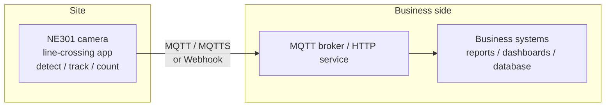

# Engineering Guide

This page is for implementation and integration engineers, covering the complete engineering process of the line-crossing statistics solution: selection, installation, configuration, data integration and daily operations. For positioning and business value, see the [Solution Description](solution-description).

## 1. Scenarios

The solution has one core action: **draw a counting line in the view and count what crosses it**. With the bundled person-detection model, typical scenarios include:

| Scenario | Counting criteria | Typical use |
|---|---|---|
| Store entrance | Bidirectional footfall | Staffing, merchandising, conversion analysis |
| Corridor / route | One-way or bidirectional flow | Route heat, peak-hour identification |
| Office / workshop gate | In/out statistics | On-site headcount, commute pattern analysis |

What gets counted is decided by the on-device model. Two paths to a new scenario (deployment and switching steps in 4.3):

- **Ready-made models**: download scenario-tuned models from the [CamThink Model Zoo](https://www.camthink.ai/developer-center/models/)
- **Your own models**: train a detection model on field samples for special targets — see [Model Training and Deployment](../../neoeyes-ne301-series/application-guide/model-training)

### Site Selection

- **Framing**: tilt the lens down to cover the counting cross-section; keep targets large enough in the frame (too far/small causes misses); aim for even lighting and avoid backlight
- **Line placement**: the line crosses the counting cross-section, roughly perpendicular to the direction of travel; leave room on both sides so targets pass fully inside the frame
- **Power & connectivity**: realtime counting needs continuous power — prefer a Type-C power supply; choose the PoE module where Ethernet is convenient (one cable for power and data); choose Cat-1 for outdoor sites without Wi-Fi
- **Install check**: before fixing the bracket, confirm in the app live view that targets are large enough, the line can span the cross-section, and the direction semantics are correct (outside faces incoming targets)

<!-- TODO (on-site capture): mounting position diagram -->

## 2. Components (BOM)

| # | Item | Model / Spec | Qty | Purpose |
|---|---|---|---|---|
| 1 | **NE301 AI camera** | STM32N6, 0.6 TOPS; comm module per site: Wi-Fi 6 / Cat-1 / PoE | 1 per site | On-device detection, tracking, line-crossing counting |
| 2 | line-crossing app | `.neapp` app package, delivered with the solution | 1 set | Line configuration, realtime statistics, window reports |
| 3 | Power accessories | Type-C power / PoE (matched to comm module) | As needed | Camera power |
| 4 | Network accessories | Wi-Fi AP / PoE switch / SIM card (per comm module) | As needed | Camera connectivity and data backhaul |
| 5 | Business system receiver | MQTT broker (incl. MQTTS) or HTTP Webhook service | 1 set | Receives window reports |

> Low-cost starting point: **1× NE301 (Type-C power + Wi-Fi) + the app package + any existing MQTT/Webhook receiver** completes one site; adding sites only adds cameras — the receiver stays.

## 3. Network Topology



General requirements:

- Only IP reachability between camera and receiver is required; the receiver can stay on the local network (data never leaves) or integrate with the cloud as needed
- MQTT and Webhook are two independent channels, toggled separately in the app's Advanced page: use either one, or enable both for redundancy
- During outages, window reports buffer on the device within capacity and are re-sent best-effort after recovery; reports not yet delivered may be lost on power failure — for critical statistics, reconcile daily on the business side (see 5.4)

## 4. Setup

Follow this order: camera onboarding → app installation → model and target class → line drawing → parameters → statistics & reporting → commissioning. With the bundled person model, confirming the class in 4.3 is enough.

### 4.1 Camera Onboarding

1. Assemble the NE301, connect power and network — see the [NE301 Quick Start](../../neoeyes-ne301-series/quick-start)
2. Open the camera web interface in a browser and sign in
3. Confirm **Application Management** exists in the left navigation (i.e. the firmware includes the app host); if the firmware lacks it, flash the [app-host firmware from the ne301 repository](https://github.com/camthink-ai/ne301/tree/app-host) first

### 4.2 Install the line-crossing App

1. Download the line-crossing `.neapp` package from the [ne30x-app Releases](https://github.com/camthink-ai/ne30x-app/releases) page
2. Go to **Application Management → ⚙ Manage App** and follow the prompts to import the `.neapp` package

   <!-- TODO (on-site verification): fresh-install flow screenshots; server configuration fields of the MQTT/MQTTS and Webhook tabs (field table to be added after on-site verification) -->

3. After installation the app shows **Installed / Running**, with the live view and app UI embedded in the App Status page
4. App management actions:

| Action | Behavior |
|---|---|
| Stop | Stops the app; **the app must be stopped before update or uninstall** |
| Update App | Disabled while running ("The app is running, so it cannot be updated or uninstalled. Stop the app first, then try again."); normal upgrades keep business data |
| Uninstall App | Disabled while running; uninstalling **also clears the app's business configuration, cumulative counts and pending reports**; a reinstall starts from zero |

### 4.3 Set the Model and Target Class

What gets counted is decided by the on-device detection model: **settle the model and target class before drawing the line**. The bundled person-detection model works out of the box — for footfall counting only, confirm the target class is person and continue with 4.4; switching targets involves two steps: replacing the detection model and switching the target class, both done on the device.

**Model sources and deployment**

- **Ready-made models**: download scenario-tuned models (PT / ONNX / TFLite) from the [CamThink Model Zoo](https://www.camthink.ai/developer-center/models/)
- **Your own models**: train a model for your scenario and targets — the full YOLO training → TFLite export → quantization → deployment flow is in [Model Training and Deployment](../../neoeyes-ne301-series/application-guide/model-training)
- **Deploy to the device**: the Web UI upload is recommended (chapter 4 of the guide above; the model package can also be uploaded via System Settings → Firmware Upgrade); once in place, the app can bind to it

<div style={{ display: 'flex', justifyContent: 'center' }}>
  
</div>

*Model upload entry: Feature Debugging → Camera Settings → upload — pick the model file, and the device loads it*

**Setting / switching the target class (in the app)**

1. Configuration page → Basic settings → **Target class**: the dropdown lists every class of the currently bound model; the current model name is shown below

2. Pick the new class and save — the app asks for confirmation: **"Changing the target class starts a new statistics period: current window counts, totals and events will be cleared. Continue?"**
3. Once confirmed it takes effect: the tracker is rebuilt around the new target and a new statistics period starts

<div style={{ display: 'flex', justifyContent: 'center' }}>
  
</div>

*Configuration page: the Target Class dropdown lists the classes of the currently bound model; the current model is shown below*

Clearing semantics of switching the target class:

| Data | After switching the target class |
|---|---|
| Window counts / totals / crossing events | Cleared; a new statistics period starts |
| Already-delivered historical window reports | Kept, unaffected |
| Report sequence `report_seq` | Never rewinds, keeps increasing monotonically |
| Line / tracking parameters / reporting settings | Kept unchanged |

<!-- TODO (on-site verification): whether the app needs a restart to pick up the class list of a newly deployed model (to be confirmed on site) -->

### 4.4 Drawing the Line and Direction

1. Realtime Data page → **Draw Counting Line**: two clicks place the two endpoints; drag either endpoint to fine-tune (mouse and touch supported)
2. IN/OUT semantics come from the line's inside/outside: a target crossing from outside to inside counts as IN, the reverse as OUT; if the direction is wrong, tap **Swap IN/OUT Direction**
3. A mistaken line can be cleared with **Reset** (resets the line) and redrawn
4. After saving, the configuration takes effect once validated by the device; changing the line only affects future judgement — **cumulative counts are kept** (to redefine the counting baseline use "Reset Statistics", see 4.7)

<div style={{ display: 'flex', justifyContent: 'center' }}>
  
</div>

*Realtime Data page: detection box, counting line, direction arrow and motion trajectory overlaid in real time*

After a crossing, the statistics update immediately and the Recent Crossing Events table gains a record (track ID, detected object, direction, time):

<div style={{ display: 'flex', justifyContent: 'center' }}>
  
</div>

*Crossing count: OUT 7→8, Total OUT 12489→12490, event #8 person OUT logged*

### 4.5 Parameters

The Configuration page has two groups; changes apply after saving.

**Basic settings**

| Field | Purpose | Notes |
|---|---|---|
| Counter name | Written to `counter.counter_name` in reports | Name it per cross-section (e.g. "footfall"); distinguishes multiple sites |
| Target class | The bound detection target | Decided by the on-device model — see 4.3 for setting and switching; **changing it clears cumulative counts and requires confirmation** |

**Tracking parameters** (affect tracking and crossing sensitivity)

| Field | Purpose | Range | When to adjust |
|---|---|---|---|
| Confidence threshold (0-1) | Detection acceptance bar | 0–1 | False positives → raise; misses → lower |
| Association distance (0-1) | Frame-to-frame target association radius | 0–1 | Fast targets / large frame → raise; mismatched IDs → lower |
| Track history length | History points kept per track | 4–16 | Raise when crossing judgement needs smoother trajectories |
| Max lost frames | Consecutive misses a track survives | ≥1 | Raise for frequent brief occlusions to avoid double counting from broken tracks |
| Confirmation frames | Frames before a track is confirmed | ≥1 | Raise against jitter-induced false positives; lower for faster response |

> Tune on site: lowering confirmation/lost frames may introduce double counting; raising them may miss fast-moving targets.

### 4.6 Statistics and Reporting

The Advanced page has two groups, **saved independently**.

**App-owned settings** (statistics)

| Field | Purpose | Notes |
|---|---|---|
| Statistics window (minutes) | Aggregation period of window reports | 1–1440 minutes; start with 5 minutes for footfall |
| Include tracks | Attach crossing track details to window reports | Enable when crossings need review; increases data volume |

**Host-owned settings** (reporting channels)

| Field | Purpose | Notes |
|---|---|---|
| MQTT reporting | Enables the MQTT channel | Server configured in the **MQTT/MQTTS** tab |
| Webhook reporting | Enables the Webhook channel | Server configured in the **Webhook** tab |
| Offline backlog capacity | Reports buffered during outages | Configurable range is device-specific; once full, new reports stop queuing |

### 4.7 Commissioning

1. **Counting**: walk back and forth through the line several times at normal speed — the realtime IN/OUT statistics match, with matching records in Recent Crossing Events
2. **Clean baseline**: before formal counting, tap **Reset Statistics** (dialog: "This will reset cumulative counts, events and the offline backlog. This cannot be undone. Business configuration is not affected.")
3. **Reporting**: subscribe on the business side / check Webhook logs — window reports arrive at the configured period
4. **Backlog**: disconnect for more than one window, reconnect, and confirm buffered reports arrive

When all four checks pass, site acceptance is complete.

## 5. Data Integration

### 5.1 Report Mechanics

- The app generates `line_counting` window reports at the statistics period; the device sends them over MQTT / Webhook — the app never opens its own network connections
- Every report carries `report_seq` (monotonically increasing) and `boot_id` (current boot identifier): consumers deduplicate and order by `boot_id + report_seq`; retries or re-sends may produce duplicates
- Time fields are device uptime milliseconds in the current version (`window.start_ms / end_ms`), with `reported_at` empty — build the timeline from reception time and detect reboots via `boot_id`
- Offline backlog is best-effort: buffered within capacity, re-sent after recovery; requests already in flight cannot be recalled

### 5.2 Window Report Fields (v4.2.8)

| Field | Type | Description |
|---|---|---|
| `type` | string | Fixed `line_counting` |
| `device_id` | string | Device identifier |
| `app.app_id` / `app.sw_version` | string | App identifier and version |
| `boot_id` | number | Current boot identifier; changes on reboot |
| `report_seq` | number | Report sequence, monotonically increasing |
| `clock_valid` | boolean | Whether the device clock is valid (false in the current version) |
| `reported_at` | null | Reserved wall-clock time; empty in the current version |
| `window.start_ms` / `end_ms` | number | Statistics window start/end (device uptime ms) |
| `window.duration_sec` | number | Window duration (seconds) |
| `window.in` / `window.out` | number | IN / OUT counts of this window |
| `window.carried_in` / `carried_out` | number | Counts accumulated before an app restart within this window, restored after the restart |
| `window.data_quality.complete` | boolean | Whether this window's data is complete (no stream loss / dropped frames) |
| `window.data_quality.gaps` | number | Stream interruptions within the window |
| `window.data_quality.lost_frames` | number | Dropped frames |
| `window.data_quality.frames_unusable` | number | Unusable frames |
| `total.in` / `total.out` | number | Cumulative IN / OUT since the last reset |
| `counter.counter_name` | string | Counter name (set in Configuration) |
| `target.class_name` | string | Target class |
| `model.name` / `model.version` | string | Currently bound detection model |
| `line.x1 / y1 / x2 / y2` | number | Counting line endpoints (permille 0–1000, resolution-independent) |
| `line.outside_x / outside_y` | number | Outside reference point (permille) |
| `config.confidence_threshold` | number | Confidence threshold when the report was generated (permille) |

### 5.3 Report Example

```json
{
  "type": "line_counting",
  "device_id": "NE301-XXXXXXXX",
  "app": { "app_id": "line-crossing", "sw_version": "4.2.8" },
  "boot_id": 3,
  "report_seq": 128,
  "clock_valid": false,
  "reported_at": null,
  "window": {
    "start_time": null,
    "end_time": null,
    "start_ms": 3600000,
    "end_ms": 3900000,
    "duration_sec": 300,
    "in": 12,
    "out": 9,
    "carried_in": 0,
    "carried_out": 0,
    "data_quality": {
      "complete": true,
      "gaps": 0,
      "lost_frames": 0,
      "lost_unknown": false,
      "frames_unusable": 0,
      "persist_ok": true
    }
  },
  "total": { "in": 1246, "out": 1180 },
  "counter": { "counter_name": "客流统计" },
  "target": { "class_name": "person" },
  "model": { "name": "line-crossing", "version": "1.0.0" },
  "line": {
    "x1": 420, "y1": 800, "x2": 580, "y2": 800,
    "outside_x": 500, "outside_y": 1000
  },
  "config": { "confidence_threshold": 500 }
}
```

> All values in the example are illustrative; the field structure matches app v4.2.8 and may evolve in later versions — refer to the field documentation of your delivered version.

### 5.4 Consumer Recommendations

- **Deduplication / idempotency**: `boot_id + report_seq` uniquely identifies a report; dedupe on this key
- **Timeline**: align windows to reception time or business-side clocks; unify to wall-clock time when aggregating multiple sites
- **Quality filter**: windows with `data_quality.complete = false` are for alerts and review — keep them out of official reports
- **Daily reconciliation**: compare the daily `total` against summed windows to detect missing or dropped reports

## 6. Daily Operations

| Symptom / task | Action |
|---|---|
| Check running status | Application Management → App Status: app state and realtime statistics on one screen |
| Live view not showing | The video area shows its own state (Live / Reconnecting / Unavailable), independent of app status; check the network first |
| Change configuration | Edit on Realtime Data / Configuration / Advanced and save; line and parameter changes keep cumulative counts |
| Start a new counting baseline | Reset Statistics (clears totals, events and backlog; configuration kept; irreversible) |
| Update the app | Stop the app first → Update App; normal upgrades keep business data |
| Start over | Stop the app → Uninstall App (also clears all of the app's business data; reinstall starts from zero) |
| False / missed counts | Check line placement and direction (4.4); tune tracking parameters per 4.5; if needed, train a model on field samples and switch the target class to improve accuracy (see 4.3) |

## 7. Performance and Specifications

| Item | Value |
|---|---|
| Bundled model | Person detection, delivered with the app |
| Custom models | Download examples from the [CamThink Model Zoo](https://www.camthink.ai/developer-center/models/); deploy self-trained models per [Model Training and Deployment](../../neoeyes-ne301-series/application-guide/model-training) |
| Statistics window | Configurable, 1–1440 minutes |
| Counting line | 1 per app, coordinates in permille 0–1000 |
| Cumulative baseline | Survives power loss; cleared by Reset Statistics or a target class change |
| Offline backlog | Configurable capacity, actual limit is device-specific; best-effort resend after recovery |

The solution targets traffic-trend analysis rather than metering-grade precision: accuracy depends on mounting angle, lighting and target density, and can be improved iteratively by training on field samples — always validate on site.

## 8. Support

- **Community**: [Discord](https://discord.gg/a8NbPGAJw9) / [GitHub Discussions](https://github.com/camthink-ai/community/discussions)
- **Custom solutions & volume deployment**: [Contact us](https://www.camthink.ai/company/contact-us/), mentioning site count and the integration interface of your existing system

## Learn More

- [Solution Description](solution-description)
- [NeoEyes NE301 Product Overview](../../neoeyes-ne301-series/overview)
- [NE301 Quick Start](../../neoeyes-ne301-series/quick-start)
- [Model Training and Deployment (NE301 Application Guide)](../../neoeyes-ne301-series/application-guide/model-training) · [CamThink Model Zoo](https://www.camthink.ai/developer-center/models/)
- ne30x-app open-source repo: [github.com/camthink-ai/ne30x-app](https://github.com/camthink-ai/ne30x-app)
