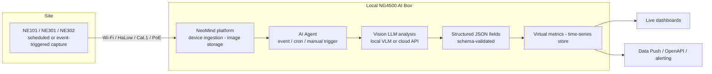

## Background

The most common way to deploy vision AI on site is to pair each recognition target with a **fixed model**: OCR for meter dials, YOLO for hard hats, face recognition for staff. These models deliver high accuracy and low latency, but they carry two inherent limitations:

- **One target, one model**: every new recognition requirement — say, moving from "detect hard hats" to "judge whether they are worn correctly" — means a new round of data collection, labeling, training, quantization and deployment. The iteration cost of long-tail scenarios never comes down.
- **Recognizes but never understands**: fixed models output classes and bounding boxes. They cannot answer open questions like "what is happening on site right now", "is there any risk", or "what should be done next".

Cloud vision APIs solve the "understanding" problem, but images leave the intranet. In factories, farms and warehouses, sending raw footage to a third party often fails security review — on top of per-call billing and the operational risk of external dependencies.

## Solution Overview

The idea behind this solution: **define the vision task in a prompt, and let a multimodal large model on-premises "read" the scene into structured data.**

Deploy a CamThink **NeoEyes** camera at each point of interest — the low-power battery **NE101**, the modular edge-AI **NE301**, or the mini integration **NE302**. Cameras capture images on a schedule or by event and send them over Wi-Fi / Cat.1 / PoE to a local **NG4500 AI Box**. Inside the box, the **NeoMind platform** hands every incoming frame to an AI Agent, which calls a multimodal LLM (vision model) to interpret the image according to your prompt, and lands the result as **schema-validated structured JSON fields** — virtual metrics written into the time-series store and rendered live on dashboards.

All model interaction happens on the NG4500: with a local Ollama vision model, **images and results never leave the premises**. When stronger reasoning is needed, an Agent can bind a cloud vision backend individually — a hybrid deployment on demand.

The prompt is the task: hard-hat inspection, shelf compliance checks, bin overflow monitoring, meter reading verification, workstation presence detection… One platform, one pipeline — **change a prompt and a few output fields, and you have a new vision application**, with no model retraining involved.

For hardware selection, BOM and deployment, see the [Engineering Guide](./engineering-guide).

## How It Works

1. **Capture & uplink** — NeoEyes cameras capture on schedule / sensor trigger / remote command and report images to NeoMind over MQTT
2. **Agent trigger** — a new frame fires the event-triggered Agent (cron and manual execution also available); the image is injected into the analysis context automatically
3. **Vision understanding** — the multimodal LLM analyzes the frame per the prompt: describe the scene, identify targets, judge states, conclude and recommend
4. **Structured ingestion** — output fields pass schema validation (Number / Text / Boolean / Enum) and land as `ai:{agent_id}:{field}` virtual metrics in the time-series store; the full reasoning chain (collect → reason → decide → conclude) is archived as JSON
5. **Visualize & integrate** — dashboards show the latest conclusions and trends; anomalies trigger alert notifications, and data reaches business systems via Data Push / OpenAPI

## Key Features

- **Prompt is the task**: no code, no retraining — switch analysis targets by editing the prompt and output fields; new scenarios go live the same day
- **Open-ended understanding**: more than detection — describes the scene, judges anomalies, explains causes, recommends actions; from "recognizing" to "understanding"
- **Data stays local**: vision models can run fully on-premises (Ollama); images, results and memory all remain on the NG4500 — intranet-only deployment with zero egress
- **Results become metrics**: LLM output passes schema validation and lands directly as time-series virtual metrics — trends, comparisons, alert rules and dashboards all work out of the box
- **Full audit trail**: every analysis binds the original capture with its complete reasoning JSON — conclusions are traceable and auditable
- **One platform, three cameras**: NE101 (battery, years of life), NE301 (edge AI + modularity), NE302 (mini integration) onboarded uniformly; pick per site conditions

## Outcomes

- Vision requirements move from "a model development cycle" to "writing a prompt" — pilot and switch costs for long-tail scenarios drop dramatically
- Conclusions land automatically and appear on dashboards in real time; inspection shifts from watching footage to watching trends
- Imagery and results stay inside the local network, meeting compliance requirements in factories, agriculture and warehousing
- Recognition quality depends on prompt quality, image clarity and model capability — validate on site before go-live; LLM judgments are probabilistic, so keep a human review channel for business-critical decisions

The following are live results from the NeoMind demo environment (construction-site PPE inspection): a structured Agent outputs people count, compliance count and violation type for every captured frame — fields become time-series metrics directly, shown alongside the capture stream.

The same pipeline with a different prompt and output fields yields the retail shelf audit and waste-container monitoring dashboards:

## Learn More

- [Engineering Guide: selection / networking / setup / integration / operations](engineering-guide)
- [NeoMind use case: camera AI pipeline and Agent vision analysis](../../neomind/use-cases/camera-ocr)
- [NeoMind platform documentation](../../neomind/product-overview/what-is-neomind)
- [NeoEyes NE101 overview](../../neoeyes-ne101-series/overview) · [NE301](../../neoeyes-ne301-series/overview) · [NE302](/docs/neoeyes-ne302-series/ne302-overview)
