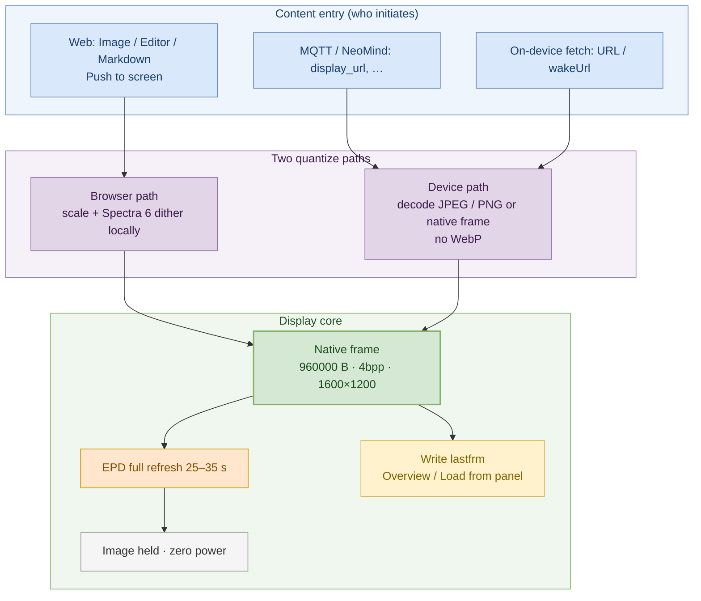
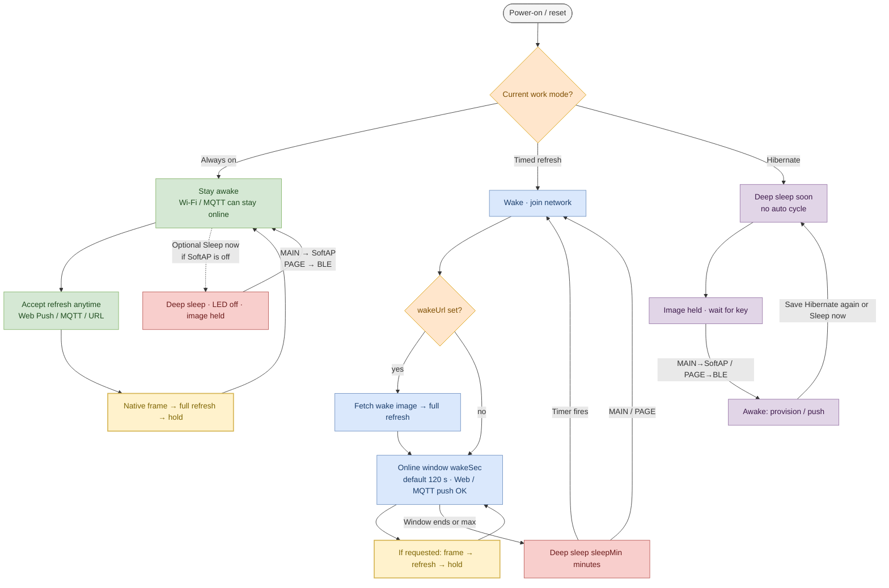

import ApplicationScenarios from '@site/src/components/ApplicationScenarios';
import SupportGrid from '@site/src/components/SupportGrid';

# Product Information

  

## Product Introduction

CamThink EK410 is **7.09″ six-color e-paper signage**: show branded information, agendas and notices on a reflective, paper-like E Ink Spectra 6 panel, update content wirelessly, and run from a rechargeable battery for desktop or wall placement without a permanent power connection.

The panel is 1200 × 1600 (282 PPI) with black / white / red / yellow / blue / green; a full refresh takes about 25–35 seconds and suits low-frequency updates. Software is fully open source: upload from the browser Web UI, or use [NeoMind](https://wiki.camthink.ai). The MCU is ESP32-C61; after SoftAP web provisioning or [NeoLinker](https://github.com/camthink-ai/NeoLinker) BLE CT-Prov, configure Wi-Fi / MQTT, push layouts, set power policy and OTA in a browser. SoftAP and BLE share **one firmware image** and are mutually exclusive at runtime.

E-paper only draws power while refreshing; the last frame stays visible when powered off — update the sign without reprinting inserts.

### Product Appearance

  <figure style={{ margin: 0, textAlign: 'center' }}>
    
    <figcaption style={{ fontSize: '0.85rem', opacity: 0.75, marginTop: '6px' }}>Front-left 45°</figcaption>
  </figure>
  <figure style={{ margin: 0, textAlign: 'center' }}>
    
    <figcaption style={{ fontSize: '0.85rem', opacity: 0.75, marginTop: '6px' }}>Front-right 45°</figcaption>
  </figure>
  <figure style={{ margin: 0, textAlign: 'center' }}>
    
    <figcaption style={{ fontSize: '0.85rem', opacity: 0.75, marginTop: '6px' }}>Rear-left</figcaption>
  </figure>
  <figure style={{ margin: 0, textAlign: 'center' }}>
    
    <figcaption style={{ fontSize: '0.85rem', opacity: 0.75, marginTop: '6px' }}>Rear</figcaption>
  </figure>

### Display Effects

The E Ink Spectra 6 panel renders black / white / yellow / red / blue / green. The samples below are front-facing renderings (not live photos).

  
  
  
  

  
  
  
  
  
  

### Key Capabilities

- **Six-color e-paper**: E Ink Spectra 6, 1200 × 1600 / 282 PPI, black / white / red / yellow / blue / green; reflective paper-like display that holds without power.
- **Battery install, wireless updates**: built-in 5000 mAh Li-polymer, USB Type-C charging; push content from the browser Web UI and reuse one unit across events and spaces.
- **Dual provisioning**: long-press MAIN for SoftAP + Web console; long-press PAGE for BLE CT-Prov (NeoLinker). Mutually exclusive in-process.
- **Multiple content sources**: local upload, image URL, canvas editor and Markdown, previewed in the browser before push.
- **NeoMind / open source**: device type `ek410_Eink`; works with open-source NeoMind; firmware and Web UI at [github.com/camthink-ai/EK410](https://github.com/camthink-ai/EK410).
- **Power policy and OTA**: always-on / scheduled refresh / hibernate; HTTPS OTA with dual-partition rollback.

## Product Specifications

Unit specifications follow the CamThink product brochure; firmware details (partitions, GPIO keys, MQTT, etc.) follow the [firmware repository](https://github.com/camthink-ai/EK410) and the Hardware / Software guides in this wiki.

<table>
  <thead>
    <tr>
      <th>Category</th>
      <th>Item</th>
      <th>Specification</th>
    </tr>
  </thead>
  <tbody>
    <tr>
      <td rowspan="7">Display</td>
      <td>Panel</td>
      <td>E Ink Spectra 6 active-matrix EPD, six colors: black / white / red / yellow / blue / green</td>
    </tr>
    <tr>
      <td>Size</td>
      <td>7.09″ (diagonal)</td>
    </tr>
    <tr>
      <td>Active area</td>
      <td>108 × 144 mm</td>
    </tr>
    <tr>
      <td>Resolution</td>
      <td>1200 × 1600 (H × V), 282 PPI</td>
    </tr>
    <tr>
      <td>Firmware canvas</td>
      <td>Logical 1600 × 1200 (native 1200 × 1600, dual driver ICs)</td>
    </tr>
    <tr>
      <td>Frame format</td>
      <td>960000-byte native 4bpp, 2 pixels per byte</td>
    </tr>
    <tr>
      <td>Full refresh</td>
      <td>About 25–35 s</td>
    </tr>
    <tr>
      <td rowspan="8">Mechanics &amp; power</td>
      <td>Dimensions</td>
      <td>185 × 149 × 14 mm</td>
    </tr>
    <tr>
      <td>Net weight</td>
      <td>0.28 kg</td>
    </tr>
    <tr>
      <td>Mounting</td>
      <td>Desktop support rod or wall mount</td>
    </tr>
    <tr>
      <td>Battery</td>
      <td>Built-in rechargeable Li-polymer, 5000 mAh</td>
    </tr>
    <tr>
      <td>Battery life</td>
      <td>Up to ~6 months (1 update per day estimate; actual life varies)</td>
    </tr>
    <tr>
      <td>Charging</td>
      <td>USB Type-C</td>
    </tr>
    <tr>
      <td>Operating temperature</td>
      <td>0–50 °C</td>
    </tr>
    <tr>
      <td>Storage</td>
      <td>−20–60 °C, 30–90% RH</td>
    </tr>
    <tr>
      <td rowspan="8">Controller &amp; interfaces</td>
      <td>MCU</td>
      <td>ESP32-C61HR2, RISC-V, 160 MHz</td>
    </tr>
    <tr>
      <td>Flash / PSRAM</td>
      <td>16 MB / 2 MB</td>
    </tr>
    <tr>
      <td>Wireless</td>
      <td>Wi-Fi 6 (802.11ax); BLE 5.0 (firmware SoftAP / STA on 2.4 GHz; brochure band list subject to delivered hardware)</td>
    </tr>
    <tr>
      <td>Memory card</td>
      <td>MicroSD (TF)</td>
    </tr>
    <tr>
      <td>Buttons</td>
      <td>Power / Reset / Switch (firmware: MAIN / PAGE / BOOT / RESET — see Hardware Guide)</td>
    </tr>
    <tr>
      <td>USB</td>
      <td>Type-C charging; CH340 USB-UART for development</td>
    </tr>
    <tr>
      <td>Cloud</td>
      <td>NeoMind, device type <code>ek410_Eink</code></td>
    </tr>
    <tr>
      <td>Local config</td>
      <td>SoftAP + Web console (<code>http://192.168.4.1</code>); NeoLinker CT-Prov</td>
    </tr>
    <tr>
      <td rowspan="4">Package</td>
      <td>E-paper display</td>
      <td>× 1</td>
    </tr>
    <tr>
      <td>Support rod for desktop use</td>
      <td>× 1</td>
    </tr>
    <tr>
      <td>USB Type-C charging cable</td>
      <td>× 1</td>
    </tr>
    <tr>
      <td>User manual (digital)</td>
      <td>× 1</td>
    </tr>
  </tbody>
</table>

## Display Update Principles

E-paper has **no continuous playback**: a refresh request triggers one **full refresh** (~25–35 s); afterward the image is **held at zero power** until the next request. The three work modes only decide **when the device is awake to accept requests** — they do not change the “native frame → full refresh” display core.

### 1. How content becomes a panel (all modes)

| Path | Typical use | Notes |
| :--- | :--- | :--- |
| **Browser path** | SoftAP / LAN console; Image upload or Editor / Markdown push | Six-color done in the browser; device receives a native frame — usually fastest |
| **Device path** | MQTT `display_url`, Timed-refresh **wakeUrl**, some URL fetches | On-device decode; **no WebP**; Quality / Speed under System → URL image applies |

### 2. Combined logic across the three work modes

Work mode lives under **System → Work mode** (Always on / Timed refresh / Hibernate). The diagram ties wake / push / sleep to the display core above:

| Mode | Display-related behavior | Typical use |
| :--- | :--- | :--- |
| **Always on** | Always awake; **anytime** Web / MQTT push; hold after refresh | Debug, frequent edits, MQTT always online |
| **Timed refresh** | Wake → optional **wakeUrl** refresh → push during `wakeSec` → sleep `sleepMin` → loop | Signage: new art every N minutes, lower power |
| **Hibernate** | Deep sleep holds art; **no timer wake**; MAIN / PAGE only, then push | Rare updates, maximum battery life |

:::note Constraints that block a refresh (not mode-specific)
- **SoftAP up**: usually stays awake; `Sleep now` is refused.
- **Full refresh in progress**: new push returns busy until the ~25–35 s job finishes.
- Only a **successful user refresh** writes `lastfrm`; SoftAP guide / boot logo do not.
:::

Steps and fields: [Power management](./2-user-guide/2-power-management.md). MQTT display commands: [MQTT Protocol](./4-software-guide/2-mqtt-protocol.md).

## NeoMind Platform Integration

After Wi-Fi and MQTT are configured, the device appears in the NeoMind device list (pending approval). Once approved you can:

- receive periodic telemetry (RSSI, battery, heap, firmware version, …);
- clear the panel, render text / canvas, pull a URL image, sleep or reboot via downlink commands;
- use platform rules or agents to call `display_url` when content changes.

Topics and command formats: [MQTT Protocol](./4-software-guide/2-mqtt-protocol.md).

## Product Applications

EK410 targets **indoor commercial signage**: information that changes between sessions, events or campaigns; battery operation for sites without permanent power; wireless updates instead of reprinting inserts. Examples below (with scenario renderings) — validate refresh rate and power before production.

<ApplicationScenarios
  introduction="Typical uses: offices and commercial spaces; meetings, events and exhibitions; boutique retail and branded counters; hospitality, campuses and public spaces. Update via the Web console or NeoMind rules."
  imagePosition="left"
  imageHeight={200}
  maxDescriptionLines={8}
  categories={[
    {
      title: 'Offices & commercial spaces',
      items: [
        {
          title: 'Department / meeting / directory signs',
          description: 'Keep posted information current without replacing paper inserts; push wirelessly when calendars change.',
          image: '/img/epaper-ek410-series/overview/scenarios/meeting.webp',
          imageAlt: 'Meeting room plaque rendering',
        },
        {
          title: 'Equipment-room status',
          description: 'Summarize racks or alert digests where paper signs are hard to keep current.',
          image: '/img/epaper-ek410-series/overview/scenarios/equipment.webp',
          imageAlt: 'Equipment room status rendering',
        },
      ]
    },
    {
      title: 'Meetings, events & exhibitions',
      items: [
        {
          title: 'Nameplates, agendas, welcome signs',
          description: 'Reassign displays between sessions and reuse them across events; six colors for headings, times and notices.',
          image: '/img/epaper-ek410-series/overview/scenarios/production.webp',
          imageAlt: 'Event board rendering',
        },
        {
          title: 'Wayfinding / parking guidance',
          description: 'Zone guidance or temporary notices; push remotely when content changes while static frames draw no power.',
          image: '/img/epaper-ek410-series/overview/scenarios/parking.webp',
          imageAlt: 'Guidance sign rendering',
        },
      ]
    },
    {
      title: 'Retail & public spaces',
      items: [
        {
          title: 'Boutique retail & branded counters',
          description: 'Product information, counter promotions and brand stories — curated displays with planned, occasional updates.',
          image: '/img/epaper-ek410-series/overview/scenarios/supermarket.webp',
          imageAlt: 'Retail counter rendering',
        },
        {
          title: 'Warehouse / bin labels',
          description: 'Location IDs, outbound queues and shift status; refresh when inventory or tasks change via platform rules.',
          image: '/img/epaper-ek410-series/overview/scenarios/warehouse.webp',
          imageAlt: 'Warehouse board rendering',
        },
      ]
    },
  ]}
/>

## Product Resources

### Wiki Guides

- [Quick Guide](./1-quick-start.md): power on, provision and push the first image.
- [User Guide](./2-user-guide/0-softap-provisioning.md): provisioning, display, power and maintenance.
- [Hardware Guide](./3-hardware-guide/0-specifications.md): specs, keys, LEDs and partitions.
- [Software Guide](./4-software-guide/0-development-environment.md): ESP-IDF setup, build and flash.

## Technical Support

When reporting issues, include the firmware version (System page in the Web console), reproduction steps and redacted logs. Do not put Wi-Fi passwords, MQTT credentials, MAC addresses or serial numbers in tickets, screenshots or public docs.

<SupportGrid />
